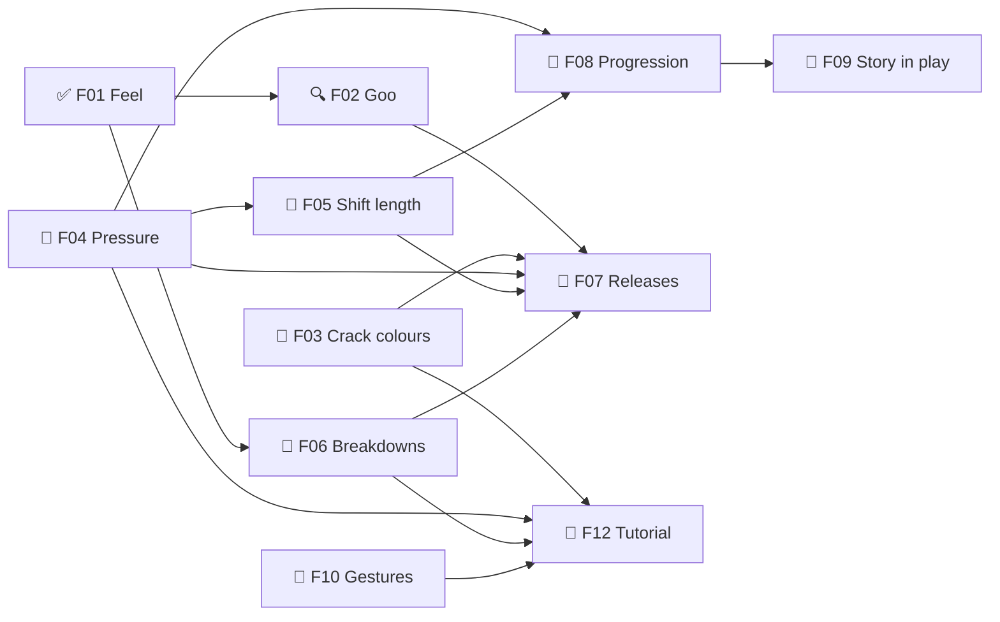

# Goops — Roadmap
Release target: not set (decided in F07)

## M0 — Design decided  ← current
Goal: every design question the remake needs is answered, so /define can write the TDD and lay out the build milestones.
- ✅ F01 ❓ Feel targets — must:alpha
  what: all three feelings, one per time scale (GDD §2)
- 🔍 F02 ❓ Goo technique: A shader vs Puyo vs v1-style — must:alpha · needs: F01
  what: which way the goo is drawn and moves (research/goo-feel.md)
  - [x] 🤖 Research goo techniques — research/goo-feel.md
  - [x] 🤖 Build the phone sketch — research/sketches/goo-sketch.html
  - [ ] 🙋 Try the sketch on the phone: gooier than v1? A or Puyo? what's missing?
  - [ ] 🤖 Write the pick into GDD §6 + TDD
- 📐 F03 ❓ Crack colours: must the goop match? What does a wrong colour do? — must:alpha
  what: covering + zapping seals a crack (settled by the story); colour rules still open
- 📐 F04 ❓ Pressure: a timer, or how full the tank is? — must:alpha
- 📐 F05 ❓ Shift length: snack (75 s) or sit-down (up to 115 s)? — must:alpha · needs: F04
- 📐 F06 ❓ Breakdowns as choices, not punishments; pause or slow at the console? — must:alpha · needs: F01
- 📐 F07 ❓ Releases: what alpha, beta and 1.0 must have — must:alpha · needs: F02, F03, F04, F05, F06
- 📐 F08 ❓ Progression: XP from score or cracks sealed? How long is the climb to 50? — must:alpha · needs: F04, F05
- 📐 F09 ❓ Story in play: fines, rank titles, ranks 40–50, the takeover — must:alpha · needs: F08
- 📐 F10 ❓ Phone gestures without conflicts — must:alpha
- 📐 F11 ❓ Look & sound: keep the v1 console art and palette, or refresh? — must:alpha
- 📐 F12 ❓ Tutorial: "your first day", taught at the moment of action — must:alpha · needs: F03, F04, F06, F10
  what: last on purpose: it teaches the settled rules

## Parking lot
- 💡 2026-10-16 — The goop is semi-sentient: maybe it acts a little on its own (creeps, reaches, hides a crack)? (Claude's suggestion)
