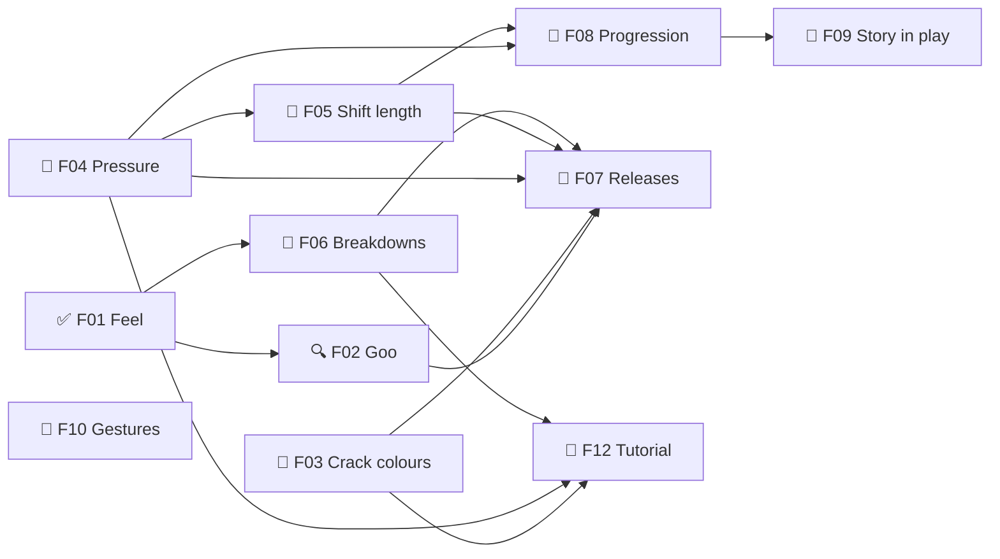
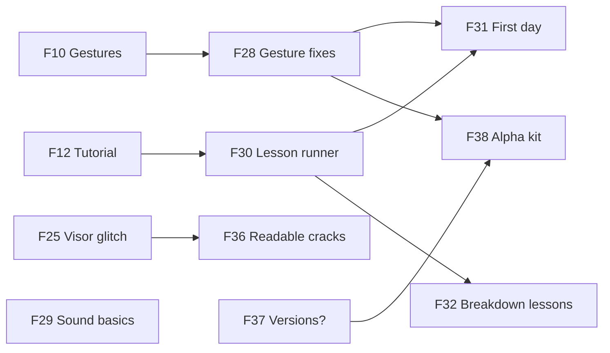

# Goops — Roadmap
Release target: alpha = M4, the playable game for Muzzy + friends (F07, 2026-10-19)

## M0 — Design decided  ← current
Goal: every design question the remake needs is answered, so /define can write the TDD and lay out the build milestones.
- ✅ F01 ❓ Feel targets — must:alpha
  what: all three feelings, one per time scale (GDD §2)
- ✅ F02 Goo technique: L4 Jelly (one soft body per same-colour group) — must:alpha · needs: F01
  what: which way the goo is drawn and moves (research/goo-feel.md, research/goo-lab/)
  note: Muzzy's feel note (2026-10-16): low gravity (env grav 2.0 m/s²) + much lower viscosity "kinda felt good" (on research/goo-lab/refs/viscous-jello-muzzy.html, his version with sliders)
  why: Muzzy's two endpoints (2026-10-16): A) "jello/jelly that has surface tension and sticks together, but can pull apart", or B) "a thick, heavy viscous liquid that doesn't really follow the grid underneath … not sure it's fun yet, so a sketch would need to prove it out"
  - [x] 🤖 Research goo techniques — research/goo-feel.md
  - [x] 🤖 Build the phone sketch — research/sketches/goo-sketch.html
  - [x] 🙋 Try the sketch on the phone. Muzzy: "that one wasn't super great", try more approaches
  - [x] 🤖 Round 2 research: videos, CodePens, techniques (metaballs, particles + blur, PBD/MPM, SDF, sticky absorb) → research/goo-lab/
  - [x] 🤖 Goo lab: L1 Pillow · L2 Splat (metaballs) · L3 Particles · L4 Jelly → planner Sketches tabs (brief: research/goo-lab/LAB-BRIEF.md)
  - [x] 🤖 L5 Free goo: playable sketch where the goo IS the rules (direction B)
  - [x] 🙋 Try the goo lab, pick A or B. Muzzy (2026-10-17): "Particle Goo, Jelly feel great in different ways, and both look great in different ways" (after tweaking a lot) → A
  - [x] 🤖 Knob presets (save 3, tap to load) + "Copy values for Claude" in every sketch; knobs dock beside the board
  - [x] 🙋 Save L3 + L4 presets, paste the values → research/goo-lab/picks.json
  - [x] 🙋 Pick: L4 Jelly. Muzzy (2026-10-17): "this feels just about right. might make small tweaks in the future"
  - [x] 🤖 Fix the jelly's heavy lurch on the way down (it was yanked a cell per grid step; now glides) + one-line help under every L3/L4 knob
  - [x] 🙋 Check the lurch is gone in L4 (its Default is now your Preset 2) — moot: Jelly is in the real game (Muzzy 2026-10-19)
  - [x] 🤖 L3: rebuilt Magnetism (same colours reach for each other) + Tension (string length before snapping), Muzzy's names; values → picks.json
  - [x] 🤖 Carried Magnetism + Tension (and sticky touch → strings) into L4 Jelly, same scale as L3, defaults 1.4 / 0.15
  - [x] 🙋 Try Magnetism + Tension in L4 Jelly — moot: Jelly is in the real game (Muzzy 2026-10-19)
  note: L3 dislikes (2026-10-17): "I don't like the pop and I don't like the way rotate looks/is handled". Don't carry L3's zap or rotate anywhere
  - [x] 🤖 Write the pick into GDD §6
  - [ ] 🤖 TDD: goo renderer + soft-body plan from lab-L4-jelly.html (when /define writes the TDD)
  note: zap look is open (2026-10-17): "since I want the laser to explode/harden the goo, the current pop anim isn't right for my goals. Let's ignore that for a moment"
- ✅ F02b Goop follows the grid (A), or free viscous goo that is the rules (B)? — must:alpha · needs: F02
  note: A (2026-10-17). Free goo was "REALLY interesting, but I don't think it's going to achieve the gameplay I'm after. If anything, that would be a different game. Let's keep the tech" (parking lot)
  what: B would change the core rules and the "goo never decides a rule" pillar; the L5 sketch proves whether it's fun first
- ✅ F03 Crack colours: v1 — only the matching colour seals; wrong colour just covers it (2026-10-17) — must:alpha
  what: covering + zapping seals a crack (settled by the story); colour rules still open
- ✅ F04 Pressure: rises over time, zaps vent it, cracks grow with it, integrity → rupture ends the shift (GDD §4) — must:alpha
- ✅ F05 Shift length: no clock — the rupture loop decides it; tuned in the balance talk (2026-10-17) — must:alpha · needs: F04
- ✅ F06 Breakdowns: v1 meters, softer effects, the tank slows at the console, simplified repairs (GDD §5, 2026-10-18) — must:alpha · needs: F01
- ✅ F07 ❓ Releases: what alpha, beta and 1.0 must have — must:alpha · needs: F02, F02b, F03, F04, F05, F06 · decided 2026-10-19: alpha = the playable game (no upgrades, no story) for Muzzy + friends; beta = the whole job (story, upgrades, all three rank twists); 1.0 = polished, replaces v1 (research/release-scope.md, GDD §7)
- ✅ F08 Progression: v1 numbers to start (XP from score), sim-check later (2026-10-17) — must:alpha · needs: F04, F05
- 📐 F09 ❓ Story in play: fines, rank titles, ranks 40–50, the takeover, what black goop does — must:beta · needs: F08
  note: Muzzy (2026-10-19, F07): "story is beta. alpha is playable game"
- ✅ F10 ❓ Phone gestures without conflicts — must:alpha · decided 2026-10-20: every finger is its own gesture (swap timer at the holding finger), taps contextual like a PC click (GDD §4, gestures.md §7)
  note: gesture list + 14-line phone checklist done (research/gestures.md); waits for Muzzy's phone session (2026-10-19: "developing fully on PC for now")
- ✅ F11 Look: Muzzy's art; kit Neon only where there's no art; pixel look later (Ideas) — sound still open — must:alpha
- ✅ F12 ❓ Tutorial: "your first day", a scripted staged day (v1 style, Muzzy 2026-10-19) — must:alpha · needs: F03, F04, F06 · decided 2026-10-19: research/tutorial.md (15 steps + 3 breakdown lessons; answers in §8)
  note: F10 dropped from needs (Muzzy 2026-10-19: teach on PC first; the phone gesture wording slots in after the phone check)
  what: last on purpose: it teaches the settled rules

## M1 — Core shift (overnight build, 2026-10-17)
Goal: one full shift plays on phone and PC with living goo; Jelly or Particle in Settings. Rules = v1 as shipped (code wins) wherever M0 is still open; each such call is a question in STATE.
- ✅ F13 Shift engine: v1 rules in a pure, seeded, tested engine — must:alpha
  what: tank wrap (30 around, 12 visible), pieces + lock feel, merge, fill, pop below the pressure line, pressure timer + refunds, cracks + sealing, score, shift end
- ✅ F14 Tank view + controls (v1 controls) — must:alpha · needs: F13
- ✅ F15 Goo overlay: Jelly + Particle, switchable in Settings — must:alpha · needs: F13, F14, F02
  why: Muzzy (2026-10-17): "make it so that In the settings I can change between particle goo or jelly goo since they are just 'overlaying' the grid below"
- ✅ F16 Shift screens: console-lite start, HUD, end-of-shift report, Settings — must:alpha · needs: F13

- ✅ F17 Pressure → integrity → rupture (GDD §4 loop) — must:alpha · needs: F13, F04
- ✅ F18 One control set + wall-kick toggle — must:alpha · needs: F14
- ✅ F19 Muzzy's art on the start + end screens — must:alpha · needs: F16

## M2 — Working day
Goal: a day at the console — periscope into a shift, back to the console, rank up, next shift. No upgrades yet, but the engine is ready for them.
- ✅ F20 Progression + save — must:alpha · needs: F08
- ✅ F21 The console as the menu (Example1) — must:alpha · needs: F20, F19
- ✅ F22 Upgrade-ready engine (modifiers + active hooks) — must:alpha · needs: F20

## M3 — Breakdowns
Goal: machines break from your own play and you fix them at the console while the tank crawls.
- ✅ F23 Breakdowns in the engine — must:alpha · needs: F06
- ✅ F24 Repairs at the console — must:alpha · needs: F23, F21
- ✅ F25 Visor glitch (sketch first) — must:alpha · needs: F23
- ✅ F26 HUD + messages rethink (from the parking lot) — must:alpha · needs: F24 · approved 2026-10-19 (message timing waits for Muzzy's dedicated playtest — sprint task 6)
- ✅ F27 ❓ Integrity / crack balance talk — must:alpha · needs: F26 · approved 2026-10-19 (crack hill, drain 0.0005, seal +2%, hockey-stick crack rate)

## M4 — Alpha: the playable game, for you + friends
Goal: a friend installs it from a link, learns to play from "your first day", and plays shifts through rank 9 with all three machines and sound — no upgrades, no story yet (Muzzy 2026-10-19: "alpha is playable game").
- ✅ F28 🎮 Gesture fixes (from F10's list) — must:alpha · needs: F10 · approved 2026-10-20 (every finger its own gesture, swap ring at the finger, touch knobs in tank.json, flick fixes)
- ✅ F29 🧱 Sound basics: recorded CC0 effects through the framework audio module, volume rows on — must:alpha · approved 2026-10-19 ("not great, but happy to have sounds"; better sounds come in F53)
- ✅ F30 🧱 Lesson runner: plain how-to-play lessons from data files (the story's intercom voice layers on in beta) — must:alpha · needs: F12
  note: built in Goops first, for the framework session to lift into a module later (Muzzy 2026-10-19)
- ✅ F31 🎮 Your first day: the rank 0 how-to-play — approved 2026-10-20 (Muzzy: "good to move forward for now"; notes later from full tests with other people) — must:alpha · needs: F30, F28
- ✅ F32 🎮 First-breakdown lessons (visor, laser, controls) — must:alpha · needs: F30
- ✅ F36 ✨ Readable cracks: bubbles, x-ray box, sealed look — should:alpha · needs: F25 · approved 2026-10-19 (+ visor scan lines in the box, pixel red X = wrong colour, covered cracks leak half the bubbles, sealed none)
- ✅ F58 🐞 Clicks beside the tank zap goop you can't see (screenToCell wraps to the hidden back) — must:alpha · fixed 2026-10-19: only the visible tank takes clicks (geometry.ts screenToVisibleCell; tests/view/geometry.test.ts + e2e/controls.mjs)
- ✅ F37 ❓ Version numbers + where alpha lives — must:alpha · decided 2026-10-19: the remake's own version.json (BMUZ X.Y.Z.B, from 0.0.0; 1.0 numbering decided when it replaces v1) · alpha lives at thebluemuzzy.github.io/GOOPS/alpha/ (same repo + Pages site, v1 untouched at the root)
- ✅ F59 🎮 Rank unlocks: next-piece window at rank 1, swap at 3, upgrades button at 5 (between the machines at 2, 4, 6) — must:alpha · needs: F30 · approved 2026-10-19, then Muzzy re-laid the HUD after playing (task 13), approved again 2026-10-19
  what: decided 2026-10-19 (Muzzy): rank 1 = the next piece shows in a window top centre (where the goop comes from) · rank 3 = swap unlocks: it trades the falling piece with the next one (the held piece is gone — "the held piece is basically just the 'next piece' now") · rank 5 = the Upgrades button at the console works (scraps bank from rank 1; grey before 5; in alpha it says the first upgrades arrive in the next update). Each unlock: a line on the end report + an interrupt lesson at the start of the first shift after it. HUD: cracks moves to the bottom beside a shorter integrity bar (3 machine bars over integrity + cracks). Kick style stays a Settings toggle from the start.
- ✅ F60 🧱 Screen look, reusable: the CRT look (glow, scan lines, typing + block cursor, wobble) as one piece any panel or text can take, quick to apply, knobs + presets in the Dev Kit — should:alpha · approved 2026-10-19
  what: Muzzy, sprint 08 retro: "that render shader should be accessible to apply to things in the future, and should feel pretty simple/fast to apply" (was an Idea 2026-10-19) · offered to the framework session as a kit effect
- ✅ F38 🧱 Alpha release kit: version.json, installable full-screen PWA, Dev Kit ON for friends (Muzzy 2026-10-19), 60 fps on two real phones — must:alpha · approved 2026-10-20 (the real-phone install + fps check happens on the live alpha right after /deliver) · needs: F37, F28

## M5 — Beta: the whole job, rank 0 to the takeover
Goal: every rank 0–50 plays, the story reaches its ending, upgrades and every v1 system are in; numbers can still be rough.
- ⏳ F33 ❓ Early upgrades: which ones for ranks 2–9, their new-loop versions and prices — must:beta · needs: F08
- ⏳ F34 🎮 Upgrade screen at the console + the early upgrades — must:beta · needs: F33, F22, F21
- ⏳ F35 🎮 Story ranks 0–9: rank titles, Employer beats, the intercom voice — must:beta · needs: F09, F30
- ⏳ F39 🎮 Rank twists as v1: multi-colour pieces (20), expanding cracks (30), wild goop (40), each with a story reason — must:beta · needs: F09
  note: Muzzy (2026-10-19): keep all three
- ⏳ F40 🎮 The Veteran: radio hijacks + smuggled upgrades — must:beta · needs: F35
- ⏳ F41 🎮 Fines on the end report — must:beta · needs: F09, F35
- ⏳ F42 🎮 Active abilities: equip slots + the charge button in the HUD — must:beta · needs: F34
- ⏳ F43 🎮 Upgrades ranks 10–38 (Hold Viewer + Goop Window retired by F59 — two slots to fill with new upgrades for the new pacing, Muzzy 2026-10-19) — must:beta · needs: F34, F42
- ⏳ F45 🎮 Ranks 40–49 + the takeover at rank 50 — must:beta · needs: F40, F39
- 🟢 F46 🎮 Operator Journal — should:beta · needs: F30
- ⏳ F47 ✨ The zap look (sketch first) — should:beta
- ⏳ F48 🎮 Quick Fix upgrade (fewer repair steps) — should:beta · needs: F34
- ⏳ F49 ❓ Covered cracks drain half? (bot rerun) — could:beta · needs: F36
- ⏳ F50 🎮 Repair bots (maybe the rank-40s upgrade band) — could:beta · needs: F43
- ⏳ F51 🧱 Economy sim: ranks 0–50, every upgrade — must:beta · needs: F43, F39

## M6 — 1.0: polished, balanced, replaces v1
Goal: Goops 2 goes live at the old address, works offline, sounds finished, and holds up from rank 0 to 50.
- ⏳ F52 🧱 Balance pass from beta playtests + the sim — must:1.0 · needs: F51
- ⏳ F53 🎮 Final sound + music + intercom voice — must:1.0 · needs: F29
  what: step 1 = swap in the sounds Muzzy finds for the 26 placeholder moments (he hunts; Claude trims, matches loudness, credits — Muzzy 2026-10-19: "add a step during polish to update sounds")
- ⏳ F54 🧱 Offline install + replace v1 at the live address — must:1.0 · needs: F38
- ⏳ F55 🎮 Credits screen — must:1.0
- ⏳ F56 ✨ Periscope zoom — should:1.0
- ⏳ F57 🎮 Colour-blind help — should:1.0

## Parking lot
- 💡 2026-10-18 — **Cracks you can read (Muzzy):** (1) an open crack lets out a slightly unsteady stream of bubbles into the tank, "as if air is getting in" — also makes it easy to spot · (2) a crack under goop stays visible: a dotted white "x-ray" box round it ("the visor is auto targeting to help") and the goop inside the box goes slightly see-through; pop that cluster → the crack seals and the box goes · (3) a sealed crack turns black/grey so it looks fixed, and no crack can ever form on a sealed spot again · (4) goop covering a crack HALVES its drain (and its bubbles). Claude's notes: (4) changes the loop — covering a crack becomes worth doing before you can pop it (stall vs. seal); the bot runs (F27) should be rerun with it. The x-ray box sits UNDER the visor glitch, so the glitch distorts it too (Muzzy 2026-10-18).
- 💡 2026-10-19 — Screen-look effects, reusable → now **F60** (sprint 09)
- 💡 2026-10-20 — **In-line icons in lesson / monitor words (Muzzy):** draw ↓, keys and buttons as small icons in the text instead of relying on the font's glyphs (the ↓ on the first-day monitor is tiny in the pixel font).
- 💡 2026-10-20 — **Rewrite the lesson script (Muzzy):** he'll rewrite the first day's words himself later ("Too full! I've cleared some." is fine for now).
- 💡 2026-10-19 — **Look like a device (Muzzy, thoughts only):** the curve alone isn't enough, "everything looks too clean" — one more "looking through a device" element. Ideas: very light scanlines over the whole tank (worry: doubled over the x-ray box's own scan lines — would need the box's to go or line up), or the pixel look below (goop made of hundreds of tiny pixel blobs). Not now; no full scanlines yet.
- 💡 2026-10-18 — **Periscope zoom (polish):** pulling the periscope down zooms INTO its visor and the shift is playing in there; swiping up zooms back out. At the console the game stays small and visible through the visor (Muzzy: "like you're actually looking directly into the periscope visor… put this for polish later")
- 💡 2026-10-17 — Free goo (L5) as its own game: "Let's keep the tech, because I really like it for something else" (Muzzy). Tech: research/sketches/lab-L5-free-goo.html
- 💡 2026-10-17 — Pixel look: the UI drawn as small pixels, and eventually the goop too ("pixellated goop would look cool") (Muzzy)
- 💡 2026-10-17 — Repair bots: an upgrade — one or more small bots float around the tank sealing cracks for you (much later) (Muzzy)
- 💡 2026-10-16 — The goop is semi-sentient: maybe it acts a little on its own (creeps, reaches, hides a crack)? (Claude's suggestion)
