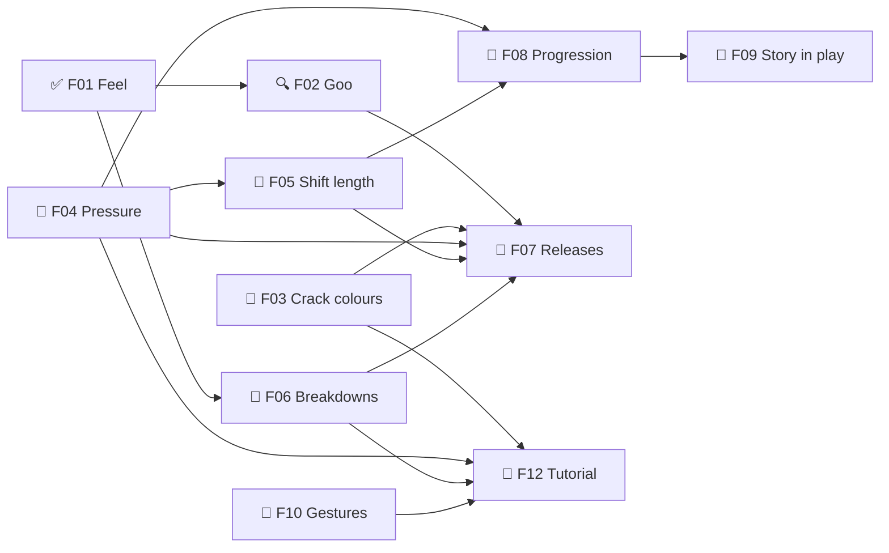

# Goops — Roadmap
Release target: not set (decided in F07)

## M0 — Design decided  ← current
Goal: every design question the remake needs is answered, so /define can write the TDD and lay out the build milestones.
- ✅ F01 ❓ Feel targets — must:alpha
  what: all three feelings, one per time scale (GDD §2)
- 🔍 F02 Goo technique: L4 Jelly (one soft body per same-colour group) — must:alpha · needs: F01
  what: which way the goo is drawn and moves (research/goo-feel.md, research/goo-lab/)
  note: Muzzy's feel note (2026-10-16): low gravity (env grav 2.0 m/s²) + much lower viscosity "kinda felt good" (on research/goo-lab/refs/viscous-jello-muzzy.html, his version with sliders)
  why: Muzzy's two endpoints (2026-10-16): A) "jello/jelly that has surface tension and sticks together, but can pull apart", or B) "a thick, heavy viscous liquid that doesn't really follow the grid underneath … not sure it's fun yet, so a sketch would need to prove it out"
  - [x] 🤖 Research goo techniques — research/goo-feel.md
  - [x] 🤖 Build the phone sketch — research/sketches/goo-sketch.html
  - [x] 🙋 Try the sketch on the phone. Muzzy: "that one wasn't super great", try more approaches
  - [x] 🤖 Round 2 research: videos, CodePens, techniques (metaballs, particles + blur, PBD/MPM, SDF, sticky absorb) → research/goo-lab/
  - [x] 🤖 Goo lab: L1 Pillow · L2 Splat (metaballs) · L3 Particles · L4 Jelly → planner Sketches tabs (brief: research/goo-lab/LAB-BRIEF.md)
  - [x] 🤖 L5 Free goo: playable sketch where the goo IS the rules (direction B)
  - [x] 🙋 Try the goo lab, pick A or B. Muzzy (2026-10-17): "Particle Goo, Jelly feel great in different ways, and both look great in different ways" (after tweaking a lot) → A
  - [x] 🤖 Knob presets (save 3, tap to load) + "Copy values for Claude" in every sketch; knobs dock beside the board
  - [x] 🙋 Save L3 + L4 presets, paste the values → research/goo-lab/picks.json
  - [x] 🙋 Pick: L4 Jelly. Muzzy (2026-10-17): "this feels just about right. might make small tweaks in the future"
  - [x] 🤖 Fix the jelly's heavy lurch on the way down (it was yanked a cell per grid step; now glides) + one-line help under every L3/L4 knob
  - [ ] 🙋 Check the lurch is gone in L4 (its Default is now your Preset 2)
  - [x] 🤖 L3: rebuilt Magnetism (same colours reach for each other) + Tension (string length before snapping), Muzzy's names; values → picks.json
  - [x] 🤖 Carried Magnetism + Tension (and sticky touch → strings) into L4 Jelly, same scale as L3, defaults 1.4 / 0.15
  - [ ] 🙋 Try Magnetism + Tension in L4 Jelly
  note: L3 dislikes (2026-10-17): "I don't like the pop and I don't like the way rotate looks/is handled". Don't carry L3's zap or rotate anywhere
  - [x] 🤖 Write the pick into GDD §6
  - [ ] 🤖 TDD: goo renderer + soft-body plan from lab-L4-jelly.html (when /define writes the TDD)
  note: zap look is open (2026-10-17): "since I want the laser to explode/harden the goo, the current pop anim isn't right for my goals. Let's ignore that for a moment"
- ✅ F02b Goop follows the grid (A), or free viscous goo that is the rules (B)? — must:alpha · needs: F02
  note: A (2026-10-17). Free goo was "REALLY interesting, but I don't think it's going to achieve the gameplay I'm after. If anything, that would be a different game. Let's keep the tech" (parking lot)
  what: B would change the core rules and the "goo never decides a rule" pillar; the L5 sketch proves whether it's fun first
- ✅ F03 Crack colours: v1 — only the matching colour seals; wrong colour just covers it (2026-10-17) — must:alpha
  what: covering + zapping seals a crack (settled by the story); colour rules still open
- ✅ F04 Pressure: rises over time, zaps vent it, cracks grow with it, integrity → rupture ends the shift (GDD §4) — must:alpha
- ✅ F05 Shift length: no clock — the rupture loop decides it; tuned in the balance talk (2026-10-17) — must:alpha · needs: F04
- ✅ F06 Breakdowns: v1 meters, softer effects, the tank slows at the console, simplified repairs (GDD §5, 2026-10-18) — must:alpha · needs: F01
- 📐 F07 ❓ Releases: what alpha, beta and 1.0 must have — must:alpha · needs: F02, F02b, F03, F04, F05, F06
- ✅ F08 Progression: v1 numbers to start (XP from score), sim-check later (2026-10-17) — must:alpha · needs: F04, F05
- 📐 F09 ❓ Story in play: fines, rank titles, ranks 40–50, the takeover — must:alpha · needs: F08
- 📐 F10 ❓ Phone gestures without conflicts — must:alpha
- ✅ F11 Look: Muzzy's art; kit Neon only where there's no art; pixel look later (Ideas) — sound still open — must:alpha
- 📐 F12 ❓ Tutorial: "your first day", taught at the moment of action — must:alpha · needs: F03, F04, F06, F10
  what: last on purpose: it teaches the settled rules

## M1 — Core shift (overnight build, 2026-10-17)
Goal: one full shift plays on phone and PC with living goo; Jelly or Particle in Settings. Rules = v1 as shipped (code wins) wherever M0 is still open; each such call is a question in STATE.
- ✅ F13 Shift engine: v1 rules in a pure, seeded, tested engine — must:alpha
  what: tank wrap (30 around, 12 visible), pieces + lock feel, merge, fill, pop below the pressure line, pressure timer + refunds, cracks + sealing, score, shift end
- ✅ F14 Tank view + controls (v1 controls) — must:alpha · needs: F13
- ✅ F15 Goo overlay: Jelly + Particle, switchable in Settings — must:alpha · needs: F13, F14, F02
  why: Muzzy (2026-10-17): "make it so that In the settings I can change between particle goo or jelly goo since they are just 'overlaying' the grid below"
- ✅ F16 Shift screens: console-lite start, HUD, end-of-shift report, Settings — must:alpha · needs: F13

- ✅ F17 Pressure → integrity → rupture (GDD §4 loop) — must:alpha · needs: F13, F04
- ✅ F18 One control set + wall-kick toggle — must:alpha · needs: F14
- ✅ F19 Muzzy's art on the start + end screens — must:alpha · needs: F16

## M2 — Working day
Goal: a day at the console — periscope into a shift, back to the console, rank up, next shift. No upgrades yet, but the engine is ready for them.
- ✅ F20 Progression + save — must:alpha · needs: F08
- ✅ F21 The console as the menu (Example1) — must:alpha · needs: F20, F19
- ✅ F22 Upgrade-ready engine (modifiers + active hooks) — must:alpha · needs: F20

## M3 — Breakdowns
Goal: machines break from your own play and you fix them at the console while the tank crawls.
- ✅ F23 Breakdowns in the engine — must:alpha · needs: F06
- ✅ F24 Repairs at the console — must:alpha · needs: F23, F21
- ✅ F25 Visor glitch (sketch first) — must:alpha · needs: F23
- 🔨 F26 HUD + messages rethink (from the parking lot) — must:alpha · needs: F24
- 🔨 F27 ❓ Integrity / crack balance talk — must:alpha · needs: F26

## Parking lot
- 💡 2026-10-17 — Free goo (L5) as its own game: "Let's keep the tech, because I really like it for something else" (Muzzy). Tech: research/sketches/lab-L5-free-goo.html
- 💡 2026-10-17 — Pixel look: the UI drawn as small pixels, and eventually the goop too ("pixellated goop would look cool") (Muzzy)
- 💡 2026-10-17 — Repair bots: an upgrade — one or more small bots float around the tank sealing cracks for you (much later) (Muzzy)
- 💡 2026-10-16 — The goop is semi-sentient: maybe it acts a little on its own (creeps, reaches, hides a crack)? (Claude's suggestion)
