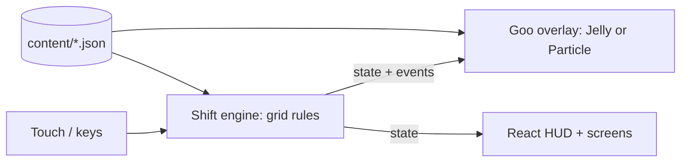
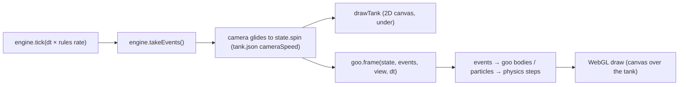
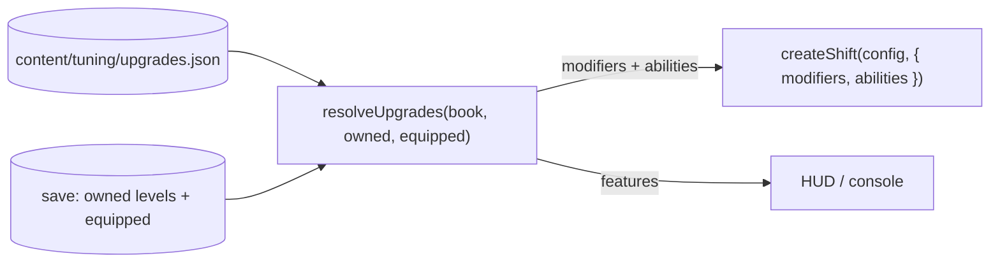

# Goops — Technical Design Document (TDD)

> How the game is built. Plain English first; code names in `backticks` only where they help.
> Living document — /define writes it, /develop keeps it true, /tdd shows it.
> Last updated: 2026-10-19 (F02 close-out: the goo written up from the real code)

## 1. At a glance
- **Platforms:** web (desktop + phone browsers), installable PWA later (like v1).
- **Stack:** Vite + TypeScript + React for screens/HUD, plus one plain WebGL2 canvas for the tank and goo. Why: the goo lab proved WebGL2 + hand-written physics runs at 60 fps; no 3D, so no R3F.
- **Where it runs online:** GitHub Pages (v1's `gh-pages` stays live until /deliver replaces it).
- **Dev Kit tools used:** Tuning (every `content/tuning/*.json`, goo knobs included — edits show live), ⏸ / ◐ Pause, Snapshots and Bug capture (`src/devkit-game/goopsAdapter.ts`).

## 2. How it fits together

- **Shift engine** (`src/engine/`): pure TypeScript, no screen, no timers of its own. Owns the tank grid (30 columns around, 24 rows), pieces, spin, merge, fill, pop, pressure, cracks, score. `tick(ms)` advances it; actions come in (`spin`, `rotate`, `softDrop`, `hold`, `pop`…); events come out (`spawn`, `move`, `rotate`, `lock`, `merge`, `ready`, `pop`, `fall`, `crack`, `reject`…). Seeded random, so a shift can be replayed.
- **Goo overlay** (`src/goo/`): reads the engine's state + events, never writes back. Two interchangeable renderers, Jelly (`src/goo/jelly/`, one soft body per group, the F02 pick, default) and Particle (`src/goo/particle/`), chosen in Settings → Goo style. First ported from the lab sketches `lab-L4-jelly.html` / `lab-L3-particles.html`; the code is now the truth (§2b).
- **Tank view** (`src/view/`): turns tank columns into screen space around the spin (the 12 visible columns of 30), draws the tank, grid lines, pressure water, cracks, ghost piece, fill progress. Shared by both goo renderers.
- **Input** (`src/input/`): v1's controls — drag sideways = spin, tap left/right half = rotate, drag down = fast drop, tap a ready blob = pop; keyboard on desktop.
- **Screens** (`src/ui/`): console-lite start, shift HUD, end-of-shift report, Settings (goo style).

**Golden rules**
- **The grid is the game, the goo is the costume.** Rules are decided by the engine's grid; the goo only shows them. Switching the goo style (or off) changes no result. (v1's I-piece locking bug came from goo physics deciding the falling piece's position.)
- Every tweakable value lives in `content/`, never hardcoded.
- The engine has no `Date.now()`, no `Math.random()` outside its seeded generator, no DOM.

## 2b. Game-specific systems
### The goo (F02 → built in F15)
**The idea:** the grid decides every rule; the goo is only a picture that follows the grid. Pillar "the goo is alive" — it jiggles, sloshes, stretches and sticks — but nothing it does is ever read back by the engine (`src/goo/types.ts`: renderers READ state + events, never write). Switching style mid-shift changes no result.

**Two looks, one plug** (`GooRenderer` in `src/goo/types.ts`: `frame`, `setKnobs`, `dispose`, `motion`):
- **Jelly** (default) — `src/goo/jelly/`. One soft body per same-colour group: a ring of outline points traced round the group's cells (`outline.ts`, rounded by `corner`). Each point is pulled toward "keep my shape" (best rigid fit of its rest shape) and "stay on my grid spot" (`home`), with damping (`viscosity`).
- **Particle** — `src/goo/particle/`. Each cell owns 9 particles on a 3×3 grid, each on a weak spring to its spot. Same colours stick (bonds + pull), other colours push apart a little so seams stay clean.
- Picked by the Settings row **Goo style** (`content/ui/settings.json` → `src/game/gooStyle.ts`); `src/game/gooFactory.ts` makes the renderer. A change rebuilds it on a fresh canvas (the canvas is keyed by style in `ShiftStage.tsx`). Shared parts: `src/goo/shared/` (springs for the falling piece, tank wrap maths, colours, knob files, WebGL helpers).

**One frame** (`src/game/ShiftStage.tsx`):

- Each frame the renderer first copies any Dev Kit edit of its knob file and of `goo-colors.json` (`followFile` in `shared/knobs.ts`), then handles the events, then steps the physics, then draws.
- A frame can carry MANY events (a slow frame, tests fast-forwarding): each event is handled against its own piece, never by adding offsets across pieces (Jelly bug fixed 2026-10-17).
- **View space** (D03): the goo simulates in cells around the camera, so when the tank turns every grid spot moves and the goo sloshes after it for free. The spawn rows above the tank are clipped off (CSS clip-path), and the shaders only draw inside the 12-column tank window (`tankWindow`, `shared/tank.ts`).

**What happens when…**
| Moment | Jelly | Particle |
|---|---|---|
| **Falling piece** | Its own body, placed by the shared piece pose (`shared/piecePose.ts`): placed by `state.spin` so it stays put while the tank slides under it; glides smoothly between rows (`piece.fall`); a rotate lags 90° behind and springs over with a little overshoot; a sideways move lags. Touching a same-colour jelly makes a sticky string (`tension`). | Same piece pose; the 4 clumps are carried with it so a rotate swings them round as one. |
| **Landing** (`lock`) | The piece's wobble is copied into the new grid body; a squash kick on the landed cells, a smaller one on their neighbours. | The clumps are handed to the locked cells by shape; a thump squashes them out and nudges neighbours (`wobble`). |
| **Merging** | Bodies are rebuilt whenever the grid or groups change. A new body copies the wobble of the nearest old points; one made from 2+ old bodies gets a merge kick. A body that split gets a string between its parts that thins and snaps (`tension`), dripping a bead. | No rebuild: same-colour particles that touch bond, so merges just happen. `magnetism` makes nearby same-colour goo reach for each other in both looks. |
| **Filling** | The fill line comes from the engine's group fill (`groupFillLines`, rises from the bottom row); it rides with the body's sag. Not-yet-filled part drawn see-through/darker (`unfilledAlpha`, `unfilledDim`); ready = glow pulse (`readyGlow`, `readyPulse`). | Same, per particle. |
| **Popping** | Placeholder (the laser "explode/harden" look is still open): home springs let go, it swells a touch, shrinks and fades over `popMs`; neighbours get a small inward kick. | Placeholder: particles shrink toward where they were and fade over `popMs`. |
| **Goop falling after a pop** (`fall`) | Cells keep where they were drawn and fall to their new spot under `gravity`, landing with a squash and re-merging. | Clumps move to their new cells and fall there (`gravity`, `landing`, `maxFall`). |
| **Poke** (a zap on goop that can't pop yet: still filling or above the line → engine `reject` with `cell`) | Squash + press-in kick on that jelly, size `poke`. | A ripple from the poked cell through its cluster, weaker further away, size `poke` × `wobble`. |
| **Tank turning** | Locked goo rides `spinCarry` of each turn at once and sloshes behind for the rest (0.5 = half the slosh, Muzzy 2026-10-18). Popping goo and drips ride the whole turn. A body crossing the wrap seam moves with its whole sim; a ring all the way round is rebuilt as the camera moves. | Same `spinCarry` rule; popping particles ride the whole turn; the falling piece isn't on the tank, so it's left alone. |
| **Hold swap** | A different piece without a spawn appears where it is. | The old piece's goo fades; the new one appears. |

**Pause and slow time** — the goo gets the frame's time × the rules clock rate (`ShiftStage.tsx`):
- Playing → normal; at the console mid-shift → slow-motion at `consoleTimeScale`; a menu → stands still.
- Dev Kit ⏸ full pause → the looks clock stops, so the goo freezes.
- Dev Kit ◐ half pause → rules stop; the goo moves only if `content/tuning/pause.json` `halfPauseGooMoves` is on. **It's `false` now**, so the goo stands still in a half pause — its ready glow pulse too (the goo's own clock only runs on the time it's given). The camera glide and the tank view's effects keep moving.

**Performance** (target in §5; `node e2e/perf.mjs` measures fps + worst frame on a 390×844@3× phone size and 1280×800 desktop, both looks, busy tank — reports only, no pass/fail line):
- Pixel ratio capped by `maxDpr` (1.5); the goo is drawn into half-res and quarter-res textures, full res only for the last pass.
- Physics steps at 120 per second. Jelly: frame time capped at 50 ms, split into sub-steps. Particle: fixed steps, at most 4 per frame — a very slow frame makes the goo slow-mo instead of piling up work.
- Particle simulates only columns within `margin` (3) of the screen, with hard caps (9,000 particles, 40,000 bonds) and a spatial hash for neighbours. Jelly simulates every body all the way round the tank and only skips drawing the off-screen ones.
- Phones without float textures fall back to 8-bit ones (both looks).

**Tests:** `tests/goo/` (colours, knob files, piece turn + glide, wrap seam, fill lines); `e2e/poke.mjs` (a click on goop that can't pop yet makes it move, both looks, via the dev hook `gooMotion`); `e2e/perf.mjs`. The dev-only goo lab (`/goo-lab.html`, `src/goo/lab/`, a fake engine) is not in the production build.

**Timers**
| Timer | Length | Owned by | Starts when | On expiry |
|---|---|---|---|---|
| Pressure rise | 0→100% in `pressure.riseMsToFull` (75 s) | engine | shift starts | caps at 100% (cracks at the top rate) |
| Crack spawn | 5 s at 0% → 1 s at 100% (`cracks.everyMsAtEmpty/AtFull`) | engine | shift starts | a crack in an empty cell at/below the pop line |
| Integrity drain | `integrity.drainPerCrackPerSec` per open crack | engine | a crack opens | integrity 0 → rupture |
| Rupture drain | 100%→0 in `rupture.drainMs` (5 s) | engine | integrity 0 or overflow | pressure 0 → shift ends (won if quota met) |
| Piece fall step | v1 speed | engine | piece spawns / steps | piece moves down a row or starts lock delay |
| Lock delay | 500 ms, max 10 resets (v1) | engine | piece touches down | piece locks |
| Fill | 375 ms × group size (v1) | engine | group formed/changed | group ready to pop |
| Pop / seal vent | v1 refund maths, ms ÷ riseMsToFull | engine | zap / seal | pressure drops |
| Visor grace | `visor.graceMs` (5 s) × `visorGraceMult` | engine (F23) | fast drop released (and shift start, repair) | the signal starts fading |
| Visor fade | 1 → `visor.breakAt` (0.10) in `visor.fadeMs` (5 s), from wherever it is | engine | grace over | breaks at 0.10 (snaps to 0.05) |
| Controls cool delay | `controls.coolDelayMs` (200 ms) | engine | each tank turn | heat cools at `coolPerSec` × `controlsCoolMult` |
| Breakdown cooldown | max(8, 20 − (rank − unlock)) s × `breakdownCooldownMult` | engine | a repair | the machine can break again (its meter was kept `cooldown.margin` above the break point) |
| Console time scale | the game ticks the engine at `consoleTimeScale` (0.25) | game | at the console mid-shift | — (the engine is purely dt-driven) |

### Lessons (F30 — the runner; the real tutorial is F31, the breakdown lessons F32)
- **F32 task 8 (Muzzy's second try):** the monitor's words (hint or lesson line) are an old DOS screen — Console.tsx `Crt` wears the CRT look (F60: `<CrtLook place="monitor">` + `<TypedText>`, src/game/CrtLook.tsx; D12) — crt.ts (`useTyping`: letters typed on the looks clock, from 0 on every new text; `crtVars`: a preset of content/tuning/crt.json as CSS variables, redrawn on a Dev Kit edit) + crt.css (glow, scan lines, block cursor as a zero-width mark's ::after, rest of the text laid out but transparent so the box never changes size; `.crt-read` = the whole text for screen readers). During a lesson only the outlined part answers: `controlAnswers(outlined, tag)` (src/game/repairs.ts) — Console passes the step's pointer tags to the panels; a control whose current tag isn't outlined is disabled and a press gives the panel's wrong shake (laser and controls panels now shake too). Portrait only: D11.
- **Engine:** `createShift({ training: {} })` = a training shift (src/engine/training.ts): empty tank, nothing held, no piece until the lesson brings one; pressure held, no natural cracks, no integrity drain, no breakdowns, no rupture (overflow rail instead), pieces stay 4 cells — each a rule a step can switch (`train({ type: 'rules' })`). `train()` also queues chosen pieces (shape, colour, turns), spawns, places goop / cracks, removes cracks, sets pressure, clears the tank. Pure + seeded; in snapshots.
- **Runner (game-agnostic):** `lessonTypes.ts` (the data format) · `patterns.ts` (v1's named building blocks: pauseShowDismiss, runActAdvance, waitThenHint, positionGated, pressureGated; retry and interrupts are step/lesson fields) · `runner.ts` (the step machine: entering → waiting → showing → advancing; one timer pool per step on the rules clock; hints, retries with a counter, skip-ahead, interrupts that resume the step, a lesson queue, checkpoints).
- **Goops side:** `goopsLessons.ts` turns set-ups into `train()` commands (cells as [column from the middle of the view, row from the floor]), answers gates (position, pressure, integrity, sealed, cracksOutOfView, wrongCover), feeds engine events + player actions to the runner, and holds the speed / input switches ShiftStage reads every frame. `LessonView.tsx` = the kit's Callout pointing at an invisible `.lesson-mark` box the frame loop keeps over the cell / piece (bent with the visor curve), or at a HUD item by `data-tag`. Words: en.json `lessons.<id>`, `{keys, mouse, phone}` by the input used last, `{placeholders}` live. The game's own messages wait while a lesson message is up.
- **Dev:** Dev Kit → Lessons tab (▶ any step, timings live, Save) · `window.__goops.lesson(id, step)` · `?lesson=<id>&step=<n>` on the next Start shift · e2e/lessons.mjs.
- **F59 unlock lessons:** `unlockLessons.ts` — `shiftStarted(rank)` (App, once the tank of a fresh REAL shift shows) queues the earliest unseen of unlock-window / unlock-swap whose part `isUnlocked` at the shift's rank — one per shift start; `atConsole(rank)` (App, on the console between shifts) starts unlock-upgrades through `lessonPlay.startAtConsole(id)` (a lesson with no shift: no set-up, nothing paused; LessonView now also draws on the idle console and Console's `Crt` shows its line there too; it finishes on the screen event `upgradesOpened`). Seen marks are the usual `lesson:<id>` (Replay lessons clears them). Pointer tags: `next-window` (the window's frame), `upgrades` (the console button). Dev + tests: `window.__goopsSeen([ids])` marks lessons seen (e2e/start.mjs skips the unlock lessons with it unless `{ unlockLessons: true }`).
- **F32 first-breakdown lessons (runner pieces added):** core — `skipIf` takes a list (any holds), step `reactions` (say something else until `until`, then the step's message comes back: "That's the pause menu…"), an `any` condition (whichever comes first; "Got it" counts when it holds `dismiss`), no breath after the last step, nothing left "running" after a finish (a queued lesson starts at once). Goops side — lessons in a REAL shift (`lessonPlay.watch(engine)`; the engine isn't wrapped), `firstBreakdowns.ts` queues `content/lessons/<machine>.json` on the first `breakdown` of each machine (once per device: kit tips memory `lesson:<machine>`, marked at the repair; leaving before it → plays again), screen events from App (`consoleOpened` / `consoleClosed` / `pauseOpened` / `pauseClosed`), setup `"console": "frozen"` (the lesson holds the tank still at the console while App runs the rules clock at full speed there, so the lesson's own timers keep time), gates `atConsole`, `broken:<machine>`, `breakdownLessonsSeen`, `{consoleSpeed}` in words, `lessons.shared` words. Pointers: HUD bars by name, console parts by `data-tag` (`repair-<machine>` = the part to do next, `panel-<machine>`, `monitor`; `periscope` = the PullHandle grip, `backToTank`, `pauseResume`), the side the message goes from the target's `data-placement` (never over the parts still to use) or the pointer's `placement`, an `or` pointer when the first isn't on screen, else the screen's middle. The console-visit note (`console-note.json`, first `consoleNoteVisits` visits outside a lesson, skipped on the cramped phone-on-its-side console). Settings → Replay lessons (`replayLessons` button row) clears the device's seen marks. Dev: `__goops.breakMachine(id, true)` also announces the break (lessons hear it).
- **F32 from Muzzy's first try (D10):** runner — a step's `insist` (`when` → the SAME message again with the game paused, the dim on and only `only` controls working — `setSpeed(speed, input, only)`; no Got it; once per step) and pointer-only steps (a pointer, no message: just the spotlight). Look — `Spotlight.tsx` (+ `spotlightMath.ts`: the dim = the screen minus the holes as non-overlapping rectangles, also the tap blocker's clip-path): holes (undimmed, tappable), pass-through (dimmed, tappable: the tank under an insisting go-to-console message, below the HUD row), one outline round all the elements carrying the pointer's tag(s) (`tags: [...]`, or several elements with one tag: the lit lamp + its slider / button / dial), `show` = more holes, the bubble inside `gameColumn()` (console screen's column, else ShiftStage's `--kit-hud-w`), its words and Got it from the first frame (Got it works after dismissArmSeconds). At the console (not a phone on its side) no bubble: `useCrtLesson` → Console.tsx's `Crt` draws the monitor's screen with the line (and Got it) and grows down like a toaster; the monitor + screen are holes. A tagged part's `data-say` swaps in its own words ("Drag the slider toward the light" / "Press the lit button"). A panel a lesson points at by `panel-<machine>` is shown lit (`showcase`). Tank input: `attachControls(…, consoleOnly)` — under an insisting message only W / ↑ / a quick flick up work. Gate `insist:<machine>` = broken for `insistSeconds` (lessons.json, 4 = the visor glitch at full strength); lessons.json `dimAmount`. Repair sliders are a real drag (`useDragOnly` wraps the kit SnapControl: a press that didn't move isn't a move); the visor slider touched at the buttons' turn shakes the panel (the buttons' wrong-press shake).

## 2c. Upgrades & abilities  (F22 — plumbing only; no real upgrade is in the game yet)
Every v1 upgrade has a home: `design/upgrades-map.md`. Three kinds, three plugs — the engine stays pure and seeded, and with no upgrades it plays **exactly** as before (tested: same events, score and tank on seeded shifts).

- **Passive → modifiers.** `Modifiers` (src/engine/upgrades.ts) is a set of named multipliers, 1 = no change, each read at the exact line that uses its tuning value: `integrityDrainMult` (× integrity drain per crack), `ruptureDrainTimeMult` (× rupture drain time), `pressureRiseTimeMult` (× pressure rise time; vents use the same total, they are "ms of rise"), `crackEveryMult` (× time between cracks), `fallSpeedMult` (× fall speed, fast drop too), `leftoverPenaltyMult` (× leftover penalty); breakdowns (F23): `laserDrainMult` (× laser drain per zapped cell — Capacitor Efficiency), `visorGraceMult` (× visor grace — Circuit Stabilizer), `controlsCoolMult` (× controls cooling — Gear Lubrication), `breakdownCooldownMult` (× the cooldown after a repair). Several upgrades on one modifier combine as (1 + sum of `add` values) × product of `mul` values, so JSON order never matters. `clampModifiers` drops unknown names, turns broken numbers back to 1 and clamps to safety rails (never 0 where the engine divides). New passives that need a new hook (Junk Uniformer, Crack Matcher) add a modifier whose neutral value takes **no extra random rolls**, so seeded shifts stay the same.
- **Active → ability hooks.** `createShift({ abilities: AbilitySpec[] })`; `state.abilities = [{ id, effect, charge 0..1, ready }]`. Charge comes from play time (`chargePerSecond`) and seals (`chargePerSeal`), only while the phase is `playing` (not during a rupture). `act({ type: 'ability', id })` fires a ready one: the effect's fire function (src/engine/abilities.ts `ABILITY_EFFECTS`) starts it or says no (→ `reject`, charge kept). Lasting effects live in `state.effects` (e.g. `lowCracks: { id, left, rows }`) and the engine reads them where they bite (crack spawn). Events: `abilityReady`, `ability`, `abilityEnd`.
- **Feature → flags.** `resolveUpgrades(...).features` = flag → level (e.g. next-piece window, hold viewer, ability slots). Screens read them; the engine already exposes next/held pieces.
- **Not the engine's:** hold-to-swap time (input), the broken-controls slow held spin (input), the visor glitch (drawn from `machines.visor.health`), console time scale (Focus Mode → the screen's `tick`).
- **Proof:** two `testOnly` upgrades in upgrades.json — *Sturdy tank (test)* (integrity drain × 0.5) and *Low cracks (test)* (2 seals to charge; the next 3 cracks form in the bottom 4 rows). `playableUpgrades()` never returns test-only ones; nothing in the game reads upgrades.json yet.

## 3. Data the game reads
| File | What's in it | Edited with |
|---|---|---|
| `content/tuning/shift.json` | tank size, shift length, fall speed, lock delay, fill time, refunds, crack rules | Obsidian (Dev Kit later) |
| `content/tuning/breakdowns.json` | the three machines' meters (v1 numbers), unlock ranks, repair cooldown, `consoleTimeScale` (F23) | Obsidian |
| `content/tuning/upgrades.json` | upgrade definitions: type, rank, max level, per-level effects / ability charge + numbers (only the two test-only ones so far) | Obsidian |
| `content/tuning/goo-jelly.json` | Jelly's knobs (started as Muzzy's Preset 2; plain-English help for each under `_help`) | Dev Kit Tuning (live) / Obsidian |
| `content/tuning/goo-particle.json` | Particle's knobs (started as Muzzy's Preset 1; `_help` too) | same |
| `content/tuning/goo-colors.json` | colour name → hex (red, blue, green, yellow, purple, white, black); `shift.json` `colors` sets their order | same — the goo, cracks and ghost change at once |
| `content/tuning/cracks-look.json` | F36 readable cracks, looks only: `bubbles` (open cracks leak air — rate, gusts, size, speed, sway, life, alpha, colour, calm for reduce motion, max), `xray` (the dotted box round a covered crack + `gooAlpha`: how solid the goo stays inside it), `sealed` (the mended scar). The rule half (no crack on a sealed spot) is the engine's: `state.sealedCracks`, in snapshots | Dev Kit Tuning (live) |
| `content/tuning/pause.json` | `halfPauseGooMoves` (off) — does the goo keep moving in the Dev Kit's ◐ half pause | Dev Kit Tuning |
| `content/text/en.json` | player-facing words | Obsidian |
| `content/lessons/<id>.json` | F30: one lesson per file — `start` / `finish` set-up, `steps` (setup, message id, pointer, while, showAfter, advance, hint, retry, skipIf, checkpoint, pattern), `interrupts`. Words in en.json → `lessons.<id>`. Format: src/game/lessons/lessonTypes.ts; what Goops understands: goopsLessons.ts | Dev Kit Lessons tab (▶ any step, timings live, Save) / Obsidian |
| `content/tuning/lessons.json` | F30: timings shared by every lesson — Got it delay, pause between steps, slow speed, gate check rate · F32 `consoleNoteVisits` (5: how many console visits get the "25% speed" note) | Dev Kit Tuning (live) |
| `content/tuning/crt.json` | F32 → F60: the CRT look as presets any panel can take (`<CrtLook preset="dos">` / `<CrtLook place="monitor">`, src/game/CrtLook.tsx + crt.ts + crt.css). `use.monitor` = the preset the console monitor wears (a dropdown); `presets.dos` (= the F32 look) · `amber` · `off`, each with layer switches (tint, glow, scanLines, wobble, typing) and knobs: typing speed, cursor blink + width, text + glow colour, glow size/strength, scanGap/scanWidth/scanAlpha/scanSpeed (same names + meaning as cracks-look.json xray.scan*; monitor units = its art units), wobbleSize/wobbleSeconds. Reduce motion = no typing, blink, wobble or roll; Dev Kit full pause holds them | Dev Kit Tuning (live) |
| `content/lessons/visor.json` · `laser.json` · `controls.json` | F32: each machine's first-breakdown lesson (broke → toConsole → fullyPaused (the very first only) → fix → fixed → back), same shape; words en.json `lessons.<machine>` + `lessons.shared` | Dev Kit Lessons tab / Obsidian |
| `content/lessons/console-note.json` | F32: the one-line console-visit note (closes on Got it, back in the tank, or after 1.5 lesson-seconds = 6 s at the console's 25%) | Dev Kit Lessons tab / Obsidian |
| `content/tuning/progression.json` | ranks + XP (v1 numbers), scraps per rank · F59 `unlocks` = the rank each part of the game unlocks at (`nextPiece` 1 · `swap` 3 · `upgrades` 5); `isUnlocked(what, rank)` in src/progress/progression.ts is the ONE rule the HUD, the controls (engine `swap` option) and the console ask — no rank numbers in UI code | Dev Kit Tuning (live) |
| `content/tuning/hud.json` | the shift's HUD sizes (top row room `topRowPx`, panel, bars, readout, chevrons) · F59 `nextWindow` (cols × rows cells, `cellRem`, `padCells`, `cellGap`, `cornerCells`) — the window sits at the left of the bottom panel, which is at least its height (ShiftStage adds the frame's kit gaps + border) · `bars.machineWidth` = the most of the room right of the window a machine bar takes (shared out evenly, never narrower than its name), `bars.integrityWidth` 1 = all of it | Dev Kit Tuning (live) |
| `content/lessons/unlock-window.json` · `unlock-swap.json` · `unlock-upgrades.json` | F59: the unlock lessons — one step each; the window's and swap's pause the start of the first shift after their rank (one per shift start: src/game/lessons/unlockLessons.ts), upgrading's is the console monitor's line + the Upgrades button outlined until it's opened. Words en.json `lessons.unlock-*` | Dev Kit Lessons tab / Obsidian |
| `content/ui/art.json` | which of Muzzy's pictures goes where: the console (layers cut from art/Example1.svg, each at its box in the mock-up's units; the views; periscope travel + grip; where the game writes words), end-report frame + its cut lines, buttons | Obsidian |

**Goo knobs Muzzy can change live** (Dev Kit → Tuning; the renderer picks up a changed value on the next frame — `followFile` in `src/goo/shared/knobs.ts`). Both files share most names:
- `stiffness` — how hard the goo springs back to its grid shape (Jelly 700, Particle 189). High = firm, fast jiggle.
- `viscosity` — damping / thickness (Jelly 6.5, Particle 0.21). Low = jiggles keep going.
- `wobble` — size of the kicks on land, rotate, merge, pop (Particle: also the idle wiggle).
- `gravity` — how fast loose goo falls after a pop (m/s²).
- `magnetism` — same-colour goo reaching for each other (reach 0.25 + 0.5 × this cells).
- `tension` — sticky strings: how far they stretch before they snap (0.35 + 0.75 × this cells; 0 = none).
- `spinCarry` — how much of a tank turn locked goo rides at once (0 = full slosh, 0.5 now, 1 = none).
- `poke` — how hard goop jiggles when zapped before it can pop (0 = off, 1 = gentle, 2 = big jolt).
- `translucency`, `wetness` — see-through and shine.
- `unfilledAlpha`, `unfilledDim` — how the not-yet-filled part looks; `readyGlow`, `readyPulse` — the ready-to-pop glow.
- `popMs` — pop fade length (Jelly 600, Particle 350; placeholder until the laser look is designed).
- `maxDpr` — pixel-ratio cap (performance).
- Jelly only: `home` (grid pull as a share of stiffness — also how much spinning sloshes), `corner` (outline rounding), `skin` (off).
- Particle only: `threshold` (fatter ↔ beadier edge), `blur`, `dome`, `splat`, `snap`, `landing`, `maxFall`, `margin` (columns simulated past the screen), plus `bulge`, `absorb`, `fresnel` (shading; no `_help` line yet).

## 4. Standards
- **Folders:** `src/engine` rules · `src/goo` renderers · `src/view` tank drawing · `src/input` controls · `src/ui` screens · `content/` data · `tests/` unit tests · `e2e/` Playwright checks.
- **Naming:** files `camelCase.ts`, components `PascalCase.tsx`, JSON keys camelCase.
- **Readable code:** plain names, small files, a one-line comment on anything non-obvious.
- **Tests:** engine rules get unit tests (ported from v1's tests where the rule is the same); key flows get a Playwright smoke check. Feel is judged by Muzzy.

## 5. Budgets
| | Target | How it's checked |
|---|---|---|
| Frame rate | 60 fps on a mid-range phone, full tank, either goo style | fps counter + Playwright |
| First load | < 3 s on 4G | /deliver quick check |

## 6. Security & fairness
- Single-player, no server. Nothing to cheat against yet.

## 8. Decisions log
```
D14 · 2026-10-20 · Day one's missing lesson pieces are small additions to the F30 format, not a tutorial mode (F31 spike)
  Proposed by: Claude (Sprint 10 task 9: tutorial.md §6 checked line by line → §9)
  Chose: extend what's there. Engine (training.ts): a queue's `then` fallback rule (pieces round and round + a build-up
  piece while a column is too low), decided again as each piece comes in (it must see where the last one landed — deciding
  when the piece is queued lags one piece); `freeCrack` (first free cell in view from the middle out / just out of view);
  an `overflowRail` event. Runner (game-agnostic): `if` on event/action conditions, hint `from` / `unless` / `again`,
  interrupt `from` / `to`, step `ensure`. Goops: gates + tank pointers moved to a pure `goopsGates.ts` (unit-testable on a
  real shift — goopsLessons.ts pulls in the Dev Kit and kit); colour gates; `{ crack }` / `{ goop }` pointers;
  `bar-integrity`; "play" now runs before "rules" (normal play + rails in one set-up — before, normal play wiped them).
  Not chosen: a special first-day engine mode or Goops-only runner code — the framework's lesson module would lose them.
  Everything still missing is App wiring (task 11): see tutorial.md §9.
D13 · 2026-10-19 · Swap trades with the NEXT piece; no held piece (F59)
  Proposed by: Muzzy (the held piece is "basically just the 'next piece' now"; swap unlocks at rank 3, the window at 1)
  Chose: engine `hold()` builds the next piece where the falling one is (blocked → refused, as before) and makes the
  falling piece's def the next one — so a second swap trades them back, and a lesson's chosen pieces (the queue behind
  nextDef) all still come in order. `held` / `heldCells` / `heldDef` are gone from the state and snapshots; a shift no
  longer draws a held piece at its start (so seeded piece orders changed: tests that leaned on a seed were made sturdy
  instead — sealACrack waits longer, the integrity test turns off the high-crack half drain). Swap locked = the engine
  option `swap: false` → `allows('hold')` false (the same gate lesson steps use) and the controls' `canSwap()` reads it,
  so a locked hold never starts its charging bar. Pieces' rotation centre is a plain 0, never -0 (a snapshot's JSON
  round trip turned -0 into 0 — the Dev Kit adapter test caught it with the new piece order).
  Also (Claude's calls): the next-piece window first hung centred over the tank's top edge from ShiftStage with its own
  top room; after playing, Muzzy found it far too small and the layout poor (2026-10-19, task 13) → his mock-up: CRACKS
  back in the top row's centre, the window at the left of the bottom panel (cells 0.9rem, ~3× the area), the machine
  bars in a row over one long integrity bar to its right; the tank gets the plain `topRowPx` back (taller than before
  F59's window). The window shows the piece the way up it comes in, in a fixed 3 × 6 box. Unlock lessons: one per shift start (window, then swap), not chained. The Upgrades button
  sits over the GOOPS title (the corners beside the title are too narrow on a 360 px phone) and only between shifts.
D12 · 2026-10-19 · The CRT look is one wrapper + a preset name (F60)
  Proposed by: Muzzy (sprint 08 retro: "that render shader should be accessible to apply to things in the future, and
  should feel pretty simple/fast to apply")   Chose: `<CrtLook preset="dos">` (or `place="monitor"`: the preset
  crt.json use.monitor names, a Dev Kit dropdown) around any panel + `<TypedText text=…>` for its words
  (src/game/CrtLook.tsx; knobs/typing in crt.ts; CSS in crt.css). Each layer is a data attribute on the wrapper
  (data-tint/glow/scan/roll/wobble), switched per preset in content/tuning/crt.json (dos = the F32 look exactly,
  amber, off). Scan-line knobs renamed to the x-ray box's vocabulary (scanGap/scanWidth/scanAlpha/scanSpeed; old
  scanLine 0.45 × gap 6 → scanWidth 2.7) so "scan lines" means the same in every look. The Dev Kit's full pause now
  holds the look's CSS motion too (wobble, blink, roll paused via data-paused). The monitor kept its DOM contract
  (.crt / data-tag="crt" / .crt-read / .crt-words / .crt-cursor / data-typing) and is pixel-identical before/after.
  Not chosen: a WebGL pass (text panels don't need one; the visor's shader stays its own look).
D11 · 2026-10-19 · Portrait only: the screen is locked upright where allowed, else a "Turn your phone upright" card (F32)
  Proposed by: Muzzy ("a phone held sideways should never affect the orientation of the game. the game is a portrait
  only game")   Chose: a web page can't stop a phone from turning, so src/ui/portrait.ts asks
  screen.orientation.lock('portrait') at start-up and on the first touch (Android agrees in fullscreen or as an
  installed app; elsewhere it says no, caught); and a touch phone held sideways (pointer: coarse + landscape) gets a
  full-screen kit card (src/ui/Upright.tsx, kit overlay + Screen + Panel + EmptyState, words en.json upright) that
  catches every tap while App pauses the shift with its own pause (speed 0 → the rules clock stops, input off); upright
  again, the same shift carries on. A short desktop WINDOW (mouse) is not a phone on its side and keeps its layout.
  The "phone on its side" layouts (useShort) stay for those short desktop windows. e2e/portrait.mjs.
D10 · 2026-10-19 · At the console the monitor's screen IS the lesson message; in the tank, bubbles on a spotlight (F32)
  Proposed by: Muzzy ("use the CRT panel at the top of the console as our tutorial bubbles. it just toasters down if it
  needs more room… no popups while in the console. when we're in the game, we can use the pop ups")
  Chose: Console.tsx draws the monitor's screen itself (exactly over the art's, art.json console.crt) with the hint or
  the lesson's line + Got it; a line that needs more room grows the screen down past the bezel (the toaster). In the tank
  the bubble keeps the kit Callout look but is the game's Spotlight (src/game/lessons/Spotlight.tsx): dim with several
  cut-outs and pass-through areas, ONE outline round several joined parts, the bubble inside the phone column, words +
  Got it from the first frame. The kit Callout can't do holes / a room box / a bubble-less spotlight, and the kit is a
  copy Goops doesn't edit → noted for the framework session to lift. A phone on its side (monitor off screen) gets the
  bubble back at the console.
D09 · 2026-10-19 · The lesson runner is built in Goops first, its core kept game-agnostic (F30)
D09 · 2026-10-19 · The lesson runner is built in Goops first, its core kept game-agnostic (F30)
  Proposed by: Muzzy (in-game now, a framework module later)   Chose: lessonTypes + patterns + runner know nothing
  about Goops (a LessonGame adapter + an injected clock); goopsLessons.ts is the thin Goops side — so a framework
  session can lift the core into a module. A lesson message pauses the GAME (engine tick × 0), not the rules clock,
  so the lesson's own timers keep running on the rules clock (Dev Kit ⏸ / ◐ and the pause menu still stop them).
D08 · 2026-10-18 · Breakdowns live in the engine as three meters (F23)
  Proposed by: Claude (shape) from Muzzy's F06 calls   Options: the game tracks the meters / the engine does
  Chose: the engine (src/engine/machines.ts) — the meters respond to engine actions (zap, land, spin, fast drop), so
  they stay pure, seeded and testable. createShift({ breakdowns: breakdowns.json }) switches them on; without it every
  machine stays locked (old shifts unchanged). state.machines[id] = { unlocked, health 0..1, broken, cooldownMs };
  events breakdown / repaired / prime; act({ type: 'repair', machine }) (not broken → reject). Only the laser's effect
  is a rule (first zap primes, second pops; no fill restart, unlike v1 — softer); the visor glitch is drawn by the
  game from health; the slow held spin is the input layer's. A rupture freezes the meters (repairs still work). During
  a cooldown a meter stays `cooldown.margin` (0.05) above its break point, so it can't break the instant the cooldown
  ends (v1 could). The visor fades from wherever it is (v1 recomputed from 100% and could jump up).
D07 · 2026-10-18 · The console = the main menu, cut from Muzzy's mock-up (F21)
  Proposed by: Claude   Options: rebuild it from the separate part files (ConsoleBase, Periscope…) / cut it from Example1.svg
  Chose: cut named groups out of Example1.svg (art-prep), each cropped to its box in art.json and placed at that same box
  (kit 0.12.0 ArtStage — picture units, never stretched), so it lines up exactly as he drew it. Words stripped and written
  by the game (fonts can't ship). Periscope pulled → the shift is made (paused) under the console, which slides away;
  back = the console slides up over the tank and the meter plays the XP since it last showed (meterSteps), so several
  "Next shift"s in a row all show. Kit also got PullHandle (drag or tap), LevelMeter, Screen column / swipe / slide
D06 · 2026-10-17 · Upgrades plug in as modifiers, ability hooks and feature flags (F22)
  Proposed by: Muzzy ("be coding with their interactions in mind") + Claude (shape)
  Options: v1-style upgrade-id checks scattered through the engine / named modifiers + ability registry
  Chose: one pure resolveUpgrades() turns owned levels into (a) clamped multipliers the engine reads at each tuning
  value, (b) ability specs (charge from time/seals, fire via act, effects in a registry, lasting state in
  state.effects), (c) feature flags for screens. The engine never sees an upgrade id or level; all numbers live in
  upgrades.json; no upgrades = identical shift (tested). Charging pauses during a rupture.
D05 · 2026-10-17 · Muzzy's art served from public/art/, made by scripts/art-prep.mjs (F19)
  Proposed by: Claude   Options: import from art/ via Vite / copy into public/art/ with a prep script
  Chose: prep script → public/art/ (committed) — two files need changing anyway (Title's words outlined so no font
  ships; EndGameScreen cut to its frame), art.json picks them by path, art/ stays Muzzy's source. Kit 0.11.0 got
  generic art skins (Button art up/down, Screen backdrop, Panel frame nine-way cut) — corners never stretch
D04 · 2026-10-17 · Shift loop = pressure → integrity → rupture (GDD §4)
  Proposed by: Muzzy ("I can make pressure and cracks make sense")
  Chose: no shift clock; open cracks drain tank integrity; rupture drains pressure, then the shift ends. Wall kick is a setting (Rotate vat / Shunt piece); no hard drop.
D03 · 2026-10-17 · Goo simulates in view space around the spin
  Proposed by: Claude   Options: simulate in tank space and wrap at draw / view space
  Chose: view space — spinning the tank moves every home spot, so the goo sloshes for free; the wrap seam sits off-screen
D02 · 2026-10-17 · Both goo styles kept, switchable in Settings
  Proposed by: Muzzy ("since they are just 'overlaying' the grid below")
  Chose: one overlay interface, two renderers (Jelly default)
D01 · 2026-10-17 · Plain WebGL2 + React, no R3F / no game engine
  Proposed by: Claude   Options: R3F / Pixi / plain WebGL2
  Chose: plain WebGL2 — the goo lab already runs at 60 fps this way; nothing is 3D
```

## 9. Third-party stuff
| What | Used for | License | OK for commercial? |
|---|---|---|---|
| React, Vite, Vitest, Playwright | app, build, tests | MIT / Apache-2.0 | yes |
| opentype.js (dev only) | outlines the title's words in scripts/art-prep.mjs | MIT | yes |

## 10. Risks & open questions
- Goo across the wrap seam (a group spanning column 29 → 0): handled — groups are unwrapped into one piece (`unwrapCells`, tested in `tests/goo/tank.test.ts`); a ring all the way round is cut on the far side.
- Particle goo on a full tank: already simulates only near the screen (`margin`) with caps (9,000 particles); past the cap, new cells quietly get fewer particles.
- Jelly simulates every body all the way round the tank, even off-screen ones; a very full tank on a slow phone is the case to watch (`node e2e/perf.mjs`; no pass/fail line yet).
- The pop look is a placeholder in both styles until the laser "explode/harden" look is designed.
