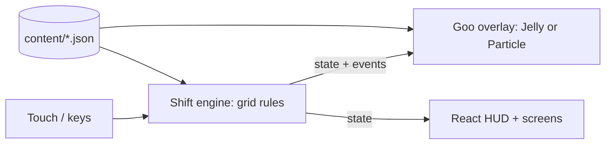

# Goops — Technical Design Document (TDD)

> How the game is built. Plain English first; code names in `backticks` only where they help.
> Living document — /define writes it, /develop keeps it true, /tdd shows it.
> Last updated: 2026-10-17 (first draft, written for the overnight M1 build; /define reviews it with Muzzy)

## 1. At a glance
- **Platforms:** web (desktop + phone browsers), installable PWA later (like v1).
- **Stack:** Vite + TypeScript + React for screens/HUD, plus one plain WebGL2 canvas for the tank and goo. Why: the goo lab proved WebGL2 + hand-written physics runs at 60 fps; no 3D, so no R3F.
- **Where it runs online:** GitHub Pages (v1's `gh-pages` stays live until /deliver replaces it).
- **Dev Kit tools used:** none yet. **Recommended next:** Tuning (the goo knobs and shift numbers already live in `content/`), Snapshots (save a board to replay a bug).

## 2. How it fits together

- **Shift engine** (`src/engine/`): pure TypeScript, no screen, no timers of its own. Owns the tank grid (30 columns around, 24 rows), pieces, spin, merge, fill, pop, pressure, cracks, score. `tick(ms)` advances it; actions come in (`spin`, `rotate`, `drop`, `pop`…); events come out (`spawn`, `move`, `rotate`, `lock`, `pop`, `fall`, `crackSeal`…). Seeded random, so a shift can be replayed.
- **Goo overlay** (`src/goo/`): reads the engine's state + events, never writes back. Two interchangeable renderers, Jelly (one soft body per group, the F02 pick) and Particle (L3), chosen in Settings. Ported from `.planning/research/sketches/lab-L4-jelly.html` and `lab-L3-particles.html`.
- **Tank view** (`src/view/`): turns tank columns into screen space around the spin (the 12 visible columns of 30), draws the tank, grid lines, pressure water, cracks, ghost piece, fill progress. Shared by both goo renderers.
- **Input** (`src/input/`): v1's controls — drag sideways = spin, tap left/right half = rotate, drag down = fast drop, tap a ready blob = pop; keyboard on desktop.
- **Screens** (`src/ui/`): console-lite start, shift HUD, end-of-shift report, Settings (goo style).

**Golden rules**
- **The grid is the game, the goo is the costume.** Rules are decided by the engine's grid; the goo only shows them. Switching the goo style (or off) changes no result. (v1's I-piece locking bug came from goo physics deciding the falling piece's position.)
- Every tweakable value lives in `content/`, never hardcoded.
- The engine has no `Date.now()`, no `Math.random()` outside its seeded generator, no DOM.

## 2b. Game-specific systems
**Real-time / visual physics** — the engine's grid decides; Jelly and Particle goo read grid + events each frame and simulate in *view space* (tank columns placed around the current spin, so spinning the tank makes the goo slosh). Nothing visual is read back by the rules.

**Timers**
| Timer | Length | Owned by | Starts when | On expiry |
|---|---|---|---|---|
| Shift / pressure | 75 s (v1) | engine | shift starts | pressure 100% → shift ends |
| Piece fall step | v1 speed | engine | piece spawns / steps | piece moves down a row or starts lock delay |
| Lock delay | 500 ms, max 10 resets (v1) | engine | piece touches down | piece locks |
| Fill | 375 ms × group size (v1) | engine | group formed/changed | group ready to pop |
| Pop refund | per v1 | engine | pop | time added back to the shift |

## 3. Data the game reads
| File | What's in it | Edited with |
|---|---|---|
| `content/tuning/shift.json` | tank size, shift length, fall speed, lock delay, fill time, refunds, crack rules | Obsidian (Dev Kit later) |
| `content/tuning/goo-jelly.json` | Muzzy's Jelly pick (`research/goo-lab/picks.json`) | Obsidian / in-game Settings later |
| `content/tuning/goo-particle.json` | Muzzy's Particle pick | same |
| `content/text/en.json` | player-facing words | Obsidian |

## 4. Standards
- **Folders:** `src/engine` rules · `src/goo` renderers · `src/view` tank drawing · `src/input` controls · `src/ui` screens · `content/` data · `tests/` unit tests · `e2e/` Playwright checks.
- **Naming:** files `camelCase.ts`, components `PascalCase.tsx`, JSON keys camelCase.
- **Readable code:** plain names, small files, a one-line comment on anything non-obvious.
- **Tests:** engine rules get unit tests (ported from v1's tests where the rule is the same); key flows get a Playwright smoke check. Feel is judged by Muzzy.

## 5. Budgets
| | Target | How it's checked |
|---|---|---|
| Frame rate | 60 fps on a mid-range phone, full tank, either goo style | fps counter + Playwright |
| First load | < 3 s on 4G | /deliver quick check |

## 6. Security & fairness
- Single-player, no server. Nothing to cheat against yet.

## 8. Decisions log
```
D03 · 2026-10-17 · Goo simulates in view space around the spin
  Proposed by: Claude   Options: simulate in tank space and wrap at draw / view space
  Chose: view space — spinning the tank moves every home spot, so the goo sloshes for free; the wrap seam sits off-screen
D02 · 2026-10-17 · Both goo styles kept, switchable in Settings
  Proposed by: Muzzy ("since they are just 'overlaying' the grid below")
  Chose: one overlay interface, two renderers (Jelly default)
D01 · 2026-10-17 · Plain WebGL2 + React, no R3F / no game engine
  Proposed by: Claude   Options: R3F / Pixi / plain WebGL2
  Chose: plain WebGL2 — the goo lab already runs at 60 fps this way; nothing is 3D
```

## 9. Third-party stuff
| What | Used for | License | OK for commercial? |
|---|---|---|---|
| React, Vite, Vitest, Playwright | app, build, tests | MIT / Apache-2.0 | yes |

## 10. Risks & open questions
- Goo across the wrap seam (a group spanning column 29 → 0): handled by view space; check a group sitting on the seam while spinning.
- Particle goo on a full 30×24 tank: up to ~6,500 particles; may need to simulate only near the visible window.
