# Goo lab: what the four videos teach (2026-10-16)

Muzzy asked us to study four videos for a better goo look than sketch 1 (which read as "beads on a string"). For each one I pulled the transcript, the title, description and chapters, and a low-res copy, then grabbed frames at the moments the transcript points to and looked at them. All four downloaded fine (videos and transcripts live in the session scratchpad, not the repo). Frames are in `frames/`.

Reminder of the ground rule from `goo-feel.md`: **the grid decides everything; the goo only draws it** and never feeds anything back to the rules.

---

## 1. Mix and Jam: "Recreating Splatoon's Ink System" (8 min, Unity)
https://www.youtube.com/watch?v=FR618z5xEiM · the part that matters is 2:13 to 5:20 and the result at 6:55.

**What it shows.** A character shoots ink. At first the ink is plain particles that look like separate beads. With the help of Bronson Zgeb, the creator turns them into one liquid stream. His method is very close to Muzzy's own idea: lots of particles, then blur plus levels.

**The recipe, step by step**
1. **Particles that already look a bit liquid.** He uses Unity's particle system, drawing each particle as a small **sphere mesh** instead of a flat sprite, and **stretches each sphere along its direction of travel** (z-scale over the flight). Moving drops become ovals instead of dots.
2. **First try: true metaballs** (Bronson's version: the particles feed a metaball field). It looked right, but it was **too expensive on the GPU even after downsampling and blurring the render texture**. That's a useful warning.
3. **Photoshop test (3:52 to 4:30).** He took a screenshot of the particles on black (white dots), then:
   - **Gaussian blur**: the dots spread and overlap, but they go see-through and grey.
   - **Levels**: crush the shadows and push up the highlights. The grey overlap snaps back to solid white with a soft, curved edge, so the dots become one blob.
4. **Ribbons between particles (4:39).** He used a particle **trail/ribbon that links each particle to the next**, an idea from Andy Saia's GDC talk "Bleeding-Edge Effects on Mobile", where **cylinders (SDF capsules) are drawn between the spheres**. The ribbons add mass between the drops, so after levels the gaps fill in and stay filled. He calls it "almost the illusion of **surface tension**." This is the part sketch 1 was missing.
5. **The real version: a custom render pass (5:00 to 5:20).** Only the ink layer is drawn into its own offscreen image, then:
   - it's **downsampled** (lower resolution, which is cheaper and blurs for free)
   - it's **blurred**: the pass has two sliders, "Blur Passes" (how many times) and "Blur Distance" (how far)
   - a **step function** is applied: a hard cut-off, the shader version of the Levels move
   - the result is composited back over the scene with the ink colour plus a highlight

   Shown side by side with the raw particles (5:18), the difference is huge.
6. **Polish:** a **glitter** sparkle in the ink shader, a noisy edge and a noise-based normal map on the painted floor, and screen shake on shooting.

**What makes it look and move gooey**
- **Look:** blur plus a hard cut-off erases each drop's own outline, so only the outer silhouette is left. The ribbons stop it breaking back into beads. A highlight on top makes it read as wet.
- **Move:** every particle flies on its own, but the outline is rebuilt each frame from all of them, so the stream stretches, necks, thins and breaks up by itself. Nobody animates the necks.

**Frames**
-  4:05. The raw particles in Photoshop: separate white dots on black.
- 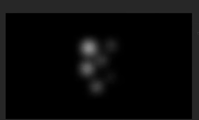 4:15. Gaussian blur only: soft, grey, overlapping, see-through.
- 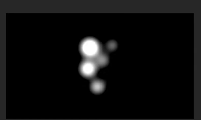 4:28. Levels applied to the blur: the dots fuse into solid blobs with round necks.
- 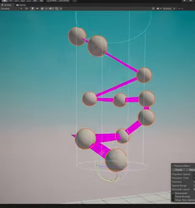 4:40. Ribbon links (pink) between the particles, which add density between the drops.
- 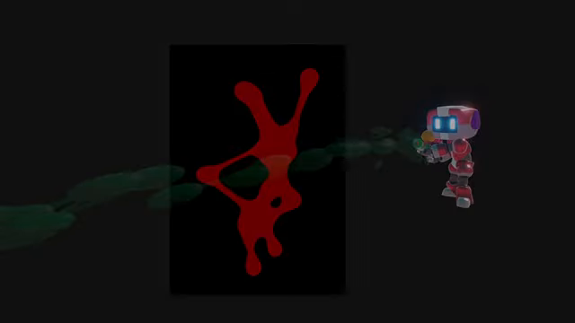 5:04. Blur, levels and ribbons together: one connected splash with necks and droplets.
- 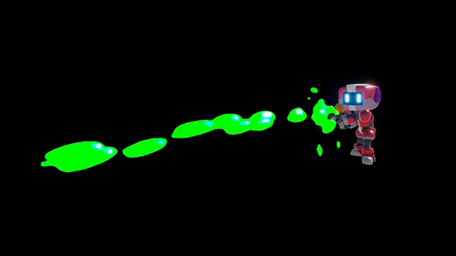 5:16. The finished custom pass in-engine: green ink lozenges with a white highlight.
- 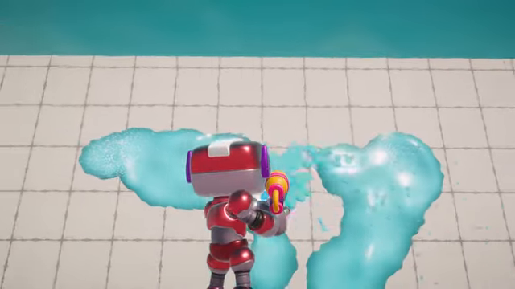 7:05. The final result: thick, wet, connected ink with a glossy edge.

**Phone cost.** Medium. A full-screen blur is the costly part, which is why they downsample first. Splatoon itself runs on Switch-class hardware. On a phone browser, the cheap way is to render the ink layer at **half or quarter resolution**, use a separable blur (two quick passes), then do the step/threshold at full resolution with `smoothstep` so the edge stays crisp. Expect about 1 to 2 ms on a mid phone for a board-sized area. The true metaballs cost was the thing they had to back away from.

**How it could apply to Goops**
- This is Muzzy's suggestion, proven: **soft dots, then blur, then a hard cut**. In Goops the "particles" can be a few dots per grid cell, which wobble and spring around their cell's home position.
- **Ribbons are the key to "one mass, not beads":** draw a thick capsule between every pair of same-colour neighbouring cells before the blur. Inside a group the gaps are fully filled, so no inner lines and no bead dimples.
- **Keep colours apart:** draw each colour into its own channel (R, G, B, A means 4 colours per texture, so 2 textures cover 8) and threshold each one on its own. Same colour fuses; different colours keep a clean seam.
- Pops and drips come free: particles flying away from a popped group stretch and pinch off on their own.

---

## 2. Franks Laboratory: "Sticky Slime Effects with Vanilla JavaScript" (29 min, canvas + CSS)
https://www.youtube.com/watch?v=PKQKIfv6yAw · the setup is 3:12 to 16:30 (plain canvas circles); the goo is 16:38 to 17:55; the effects are 20:52 (smoke monster) and 24:23 (dripping slime).

**What it shows.** A beginner-friendly build in plain JavaScript: about 20 circles drawn on a canvas, and **one CSS line turns them into metaballs**. He then builds three effects: bouncing metaballs, a wobbling "smoke monster", and a dripping lava-lamp slime.

**The recipe, step by step**
1. **Data:** a `Ball` class with x, y, radius (random 20 to 100 px) and a speed (random −0.5 to +0.5 px per frame). It bounces off the canvas edges, accounting for its radius. An `Effect` class holds the array and updates and draws every ball each frame with `requestAnimationFrame`. Each ball is drawn as a plain white `arc` fill on black.
2. **The goo, in one CSS line (16:38):** `canvas { background: black; filter: blur(10px) contrast(20); }`
   - The **blur** spreads the circles into each other.
   - The **contrast** pushes every pixel to full black or full white. That's the same Levels move as in the Splatoon video.
   - His rule of thumb: **keep contrast at about double the blur** (`blur(20px) contrast(40)` looked "more liquid and sticky"). More blur gives fatter necks that join from further away.
   - **Catch:** it only works if the canvas has a **solid background colour**. With a transparent background you get just the blur (frame 2).
3. **The transparent-background version (17:43):** an SVG filter, applied with `filter: url(#goo)`:
   - `<feGaussianBlur in="SourceGraphic" stdDeviation="10" result="blur"/>`
   - `<feColorMatrix in="blur" mode="matrix" values="1 0 0 0 0  0 1 0 0 0  0 0 1 0 0  0 0 0 15 -3"/>`

   The last row multiplies alpha by about 15 and subtracts about 3. This "alpha threshold" is the same trick v1 used. I read the values off 360p video, so treat them as about right; the classic codepen values are `18 -7`.
4. **Smoke monster (20:52):** each ball gets an angle that turns by a random `va` of −0.05 to +0.05 each frame, and its position adds `cos(angle) × range` and `sin(angle) × range` (range 0 to 20). That gives circling, wandering motion. Wall bounces break it up, so the blob "tries to escape its cage".
5. **Dripping slime (24:23):** balls start just above the top edge and fall.
   - Each ball has its own gravity, a random 0 to 0.005.
   - The key rule: **gravity only switches on once the ball is more than two radii below the top**. Until then, balls crowd at the top in a sticky mass. Once one is past the line, its speed builds up (velocity += gravity, then speed += velocity), so it **stretches out of the mass, necks, and finally drops away faster and faster**. That's the honey-drip feel, made from one if-statement.
6. **Colour note (28:07):** red works. **Green "doesn't work well" and pink "creates this border."** The reason: `contrast()` works on each colour channel separately, so a colour that mixes channels (pink, mid-green) gets pushed to different extremes in each channel, and you get coloured fringes along the blurred edge. The fix is to threshold **alpha (or a mask) only, then colour it afterwards**.

**What makes it look and move gooey**
- **Look:** the same blur-and-threshold fusion. Bigger blur means longer, softer necks before two blobs touch. That's the "reaching" Muzzy wants.
- **Move:** slow random drift plus the threshold means blobs bud off and re-merge constantly. Holding back gravity, then letting it build, gives the "sticks, then lets go" drip.

**Frames**
- 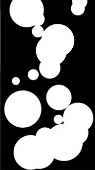 16:40. Plain circles, no filter yet.
- 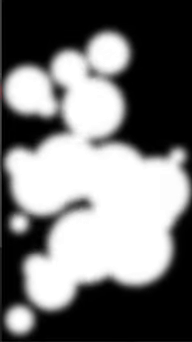 17:25. `blur(10px) contrast(20)` with no canvas background: only the blur shows (the catch).
- 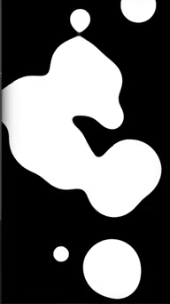 17:40. A black background added: `blur(20px) contrast(40)` gives proper metaballs with long necks.
- 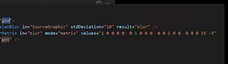 17:55. The SVG filter version (feGaussianBlur and an alpha feColorMatrix).
- 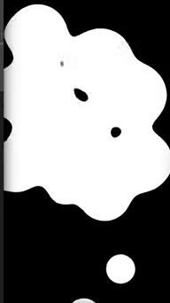 23:50. The smoke monster: one big wobbling mass with holes and budding blobs.
- 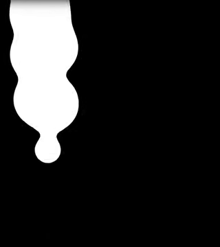 27:20. Dripping slime: a drop stretching out of the top mass, necking before it falls.
- 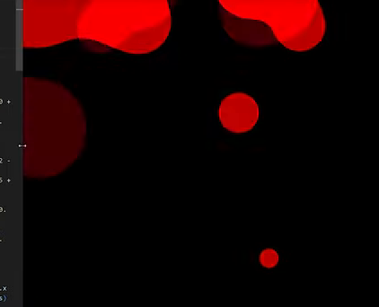 28:20. Red slime: coloured blur fringes start to show (the per-channel contrast problem).

**Phone cost.** **High in this form.** CSS and SVG blur filters on a full-screen canvas are exactly what made v1 throttle to 40fps (Safari is the worst). The idea is perfect, but the delivery is wrong for phones. **Do the same maths in a WebGL shader instead**: draw soft dots into a texture, then threshold alpha with `smoothstep`. It's the same look at a small fraction of the cost.

**How it could apply to Goops**
- **Ready-made "loose goop" behaviour:** when goop is cut loose, it hangs and clings for a moment (no gravity while it's within a cell or so of its anchor), then gravity builds up, the neck stretches and it drips away. That's a visual-only animation, and the grid has already decided where it lands.
- **Alive at rest:** give each dot inside a cell a tiny smoke-monster wander (a few pixels, slow `va`). The group's outline then breathes and shifts on its own, with no extra ripple code.
- **Neck reach = blur radius:** one Dev Kit knob that Muzzy can feel directly.
- **Lesson:** threshold a mask, then colour it in the shader. Never threshold colour.

---

## 3. Robot Bobby: "Learn Three.js: Metaballs With Physics" (8 min, three.js)
https://www.youtube.com/watch?v=jPbOKwXqdn8 · from 1:37 to the end.

**What it shows.** About 20 balls in a Rapier physics world, all pulled toward the centre of the screen (from his earlier video), plus a mouse-driven collider that shoves them around. He wraps the cluster in three.js's built-in **MarchingCubes** metaball mesh, so the balls become one shiny blob that squishes when you poke it. The idea came from a drcmda (Poimandres/R3F author) demo.

**The recipe, step by step**
1. **Physics:** Rapier rigid-body spheres with a constant pull toward the centre, which keeps them clumped, and a kinematic mouse ball they collide with. The physics only gives positions; nobody draws the spheres themselves.
2. **Metaballs (1:37):** `new MarchingCubes(96, material, true, true, 90000)`, where:
   - 96 is the grid resolution
   - the two `true`s turn on UVs and vertex colours
   - 90000 is the maximum polygon count ("affects your performance")
   - `scale.setScalar(5)` sets the size

   Then every frame: `reset()`, then for each body `addBall(x, y, z, strength 0.5, subtract 10, colour)`, then `update()`.
3. **The isolation knob (3:56): "blobbiness / size".** It started at 1000. **100** gave one huge, dark, over-merged ball. **10000** made the balls vanish (too small). **2000** looked "disgusting" (lumpy). There's a narrow sweet spot. Strength and subtract shape each ball's falloff ("size" and "smoothness").
4. **Material decides the look (4:46 to 7:00):**
   - **Matcap** (a sphere picture that gives instant lighting) looked good out of the box.
   - **Normal material**: "RGB Pepto-Bismol", bad.
   - **Glass** (`MeshPhysicalMaterial`, roughness 0, transmission 1, a thickness setting) looked dark and dull until two changes. First, **flat shading turned off**, so the surface is smooth. Second, a **scene background colour** behind it, because see-through glass has nothing to show without a backdrop. With debug colours on, the coloured inner balls show through the glass skin: "bobas inside", which he loved.

**What makes it look and move gooey**
- **Move:** real physics and a constant inward pull. Poke it and it dents, the balls shuffle, and the skin flows around them, then it settles back. The shape is never authored.
- **Look:** a single smooth skin over everything, one big highlight (matcap or glass reflection), and a translucent body with **coloured cores visible inside**. That reads as gummy or jelly.

**Frames**
- 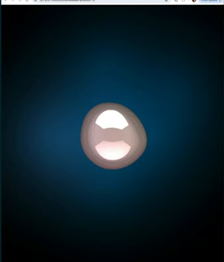 0:03. The goal: one pearly blob over the physics balls, with a matcap highlight.
- 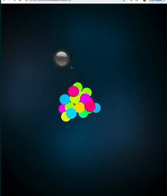 0:25. Under the hood: the coloured physics balls clumped together, plus the grey mouse collider.
- 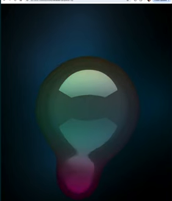 4:00. Isolation lowered: very blobby, the mouse ball's skin fuses into the main mass with a neck.
- 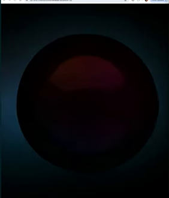 4:10. Isolation far too low: one giant dark ball, all detail lost.
- 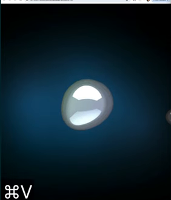 5:30. Glass material: shiny, but grey and lifeless without a backdrop.
- 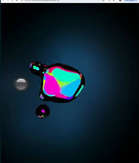 6:35. Glass with smooth shading and debug colours: coloured "boba" cores inside a clear skin.
- 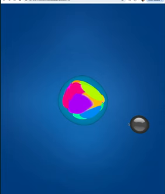 7:15. With a blue scene background, the glass blob reads as jelly.

**Phone cost.** **High for this exact method.** Marching cubes at resolution 96 means evaluating about 885,000 grid points every frame on the CPU, then building up to 90,000 triangles. It runs fine on a laptop but would be heavy on a phone, and it's 3D anyway. Goops doesn't need 3D marching cubes. The **2D version of the same field is just a fragment shader** (sum each ball's falloff per pixel, then threshold), which is cheap.

**How it could apply to Goops**
- **"Physics balls pulled toward a home, then skinned"** is the right model. Each goop cell owns a few balls with a spring pulling them to the cell's home spot. The grid moves the homes; the balls follow with lag and overshoot; the skin is drawn over them. Poke-like dents happen on landing for free.
- **Isolation (threshold) has a narrow sweet spot.** Make it a Dev Kit slider with a good default, not something to guess.
- **Matcap shading for 2D:** use the field's gradient as a fake surface normal and look up a **matcap image**. One texture gives a rich, wet, art-directable highlight, and Muzzy can paint or swap matcaps himself. That fits an artist well.
- **Translucent skin with visible cores** is an option for "ready to pop" or a stiff-jello style: draw the field's thick centre darker or brighter (thickness = field value).

---

## 4. INSYDIUM: "Constraints: Viscous Fluids Tutorial" (12 min, X-Particles in Cinema 4D)
https://www.youtube.com/watch?v=rhFYjdNe2XA · from 2:34 (the "Combining solver systems" chapter) to the end.

**What it shows.** Offline 3D VFX: a chocolate or honey pour onto a wafer. It isn't a game technique, but the idea behind it is very clear. A **fluid solver alone** gives watery splashing; a fluid solver **plus springs between neighbouring particles** gives thick, folding, shape-holding goo, fast.

**The recipe, step by step**
1. **Particles fall under gravity onto colliders.** Viscosity constraints are added: each particle is **linked by a spring to its nearby particles** (frame 1 shows the links).
2. **Fluid PBD solver alone (2:42 onward):** it behaves like water and spreads into a flat puddle. Raising the solver's own viscosity to 50% makes it "gloopy", but it still won't hold together.
3. **Fluid and constraints together (3:15):** the fluid solver **pushes particles apart** (incompressible, no overlaps), and the constraints **pull neighbours together**. The combination holds its shape.
4. **The knobs he tunes:**
   - **Stiffness:** 98% is too rigid, so he settles on 95%, then 90% for pours.
   - **Connection limit** (how many neighbours each particle may link to): 16 leaves gaps, 40 is better, and 100 to 150 is needed at high particle counts. **Too few links means stripes and gaps.**
   - **Hexagonal-grid emission** spawns particles neatly packed, so the solver doesn't "explode" them apart. **Lower spacing** spawns them overlapping on purpose: the fluid pushes out while the constraints hold, which gives a fuller, bulgy body.
   - **More substeps** (+2) make the same springs stiffer.
5. **Results:** a **thick blob that holds its shape** and slumps slowly (6:15); a **thin ribbon pour that coils and folds** like chocolate (8:10); and at high resolution, fine creases and folds (10:40).

**What makes it look and move gooey**
- Goo is **"pushes apart up close, sticks together a little further out."** Water has only the first part. The links give the slow slump, the folding and the stretchy strands; stiffness and link count set honey versus jelly.
- Its look is just shaded particles here (no skinning shown), so it adds nothing for rendering.

**Frames**
- 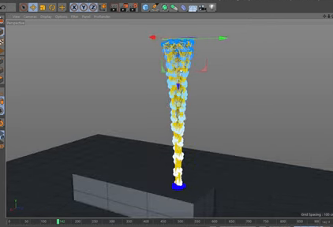 2:20. Viscosity constraints shown as links (yellow) between neighbouring particles in the falling stream.
- 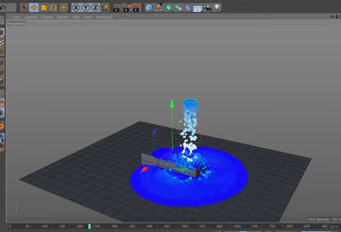 3:00. Fluid solver only: it splashes and spreads flat like water.
- 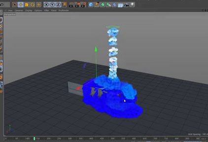 3:48. Fluid plus constraints: it piles up and holds a lumpy, gloopy shape.
- 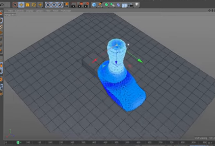 6:15. High stiffness and hexagonal emission: a thick blob that keeps its shape and slumps slowly.
- 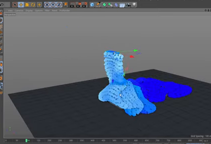 8:10. A thin ribbon pour: honey-like folding and coiling.
- 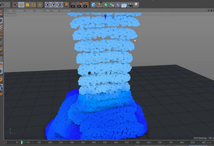 10:40. High resolution, about 150 links each: dense creases and folds.

**Phone cost.** The offline version isn't for games (thousands of particles, many substeps). The **idea is cheap in 2D**: a few hundred particles with a short-range push, a slightly longer-range pull, and a spring to a home spot. That's a small Position-Based Dynamics loop (the same family as Ten Minute Physics and LiquidFun's viscous and elastic particles). As an estimate, 300 to 600 particles in 2D should fit in a couple of ms per frame in JS on a mid phone. That still needs proving in a sketch.

**How it could apply to Goops**
- This is the **motion model** for the particle skin from videos 1 to 3: particles **repel up close**, **cohere with same-colour neighbours** (that's the sticky "absorb each other" merge), and have **a spring to their grid home** (the grid stays the boss). Different-colour particles only repel, never cohere, so colours stay separate.
- **Knobs that map to Muzzy's words:**
  - stiffness ("jello vs honey")
  - link range and link count ("how far it reaches")
  - substeps (firmness)
  - gravity scale (he liked about 1/5 gravity in the jello reference)
- **Avoid the stripes lesson:** make sure every particle can link to enough neighbours, or groups show seams.
- **Strands on separation:** when a group splits, keep the cross-links alive until they stretch past a snap length. That's Direction D's neck-that-thins-and-snaps, made from the same system.

---

## Cross-video summary: the most promising ideas for Goops

1. **Field skin, not per-cell shapes.** All three goo-looking videos get "one continuous mass" the same way: **draw soft dots, let them add up, then hard-threshold**. Splatoon does it with blur and a step; Frank with blur and contrast; Robot Bobby with a metaball field and an isolation value. For Goops, build it as a WebGL2 pass:
   - add up soft dots into a **half-res float texture, one channel per colour**
   - optionally blur once
   - in the full-res pass, use `smoothstep` around a threshold

   This replaces sketch 1's per-cell rounded boxes, which gave the beads. **Never threshold colour** (Frank's pink fringes); threshold a mask and colour it after.
2. **Ribbons/capsules between same-colour neighbours** (Splatoon, from Andy Saia's GDC talk): fill the gaps inside a group before thresholding. That gives no inner dimples and a "surface tension" look, and the same capsules become **strands that thin and snap** when goop separates.
3. **A few particles per cell on springs to the grid home, plus same-colour cohesion** (Robot Bobby's clump and INSYDIUM's push-apart/pull-together). The grid moves the homes; the particles lag, overshoot, dent on landing and slurp together. Different colours only repel. It's strictly visual: the rules never read a particle.
4. **Sticky-then-release drip** (Frank's slime): loose goop and pops cling with no gravity for about a cell, then gravity builds, so the neck stretches and the drop falls away. Low gravity (Muzzy liked about 1/5) for a floaty slosh.
5. **Shading from the field:** gradient = normal, then **matcap lookup** for an art-directable wet highlight (Muzzy can paint matcaps); field value = thickness, for a darker or more saturated core and a clearer, glowier rim (glass/jelly, "boba cores"). Keep blur and threshold on the GPU at reduced resolution: CSS and SVG filters, and CPU marching cubes, are the expensive versions to avoid on phones.

All knobs (dot radius, blur radius, threshold and edge softness, link range and stiffness, gravity scale, matcap choice) belong in `content/goo.json` with a Dev Kit panel.
