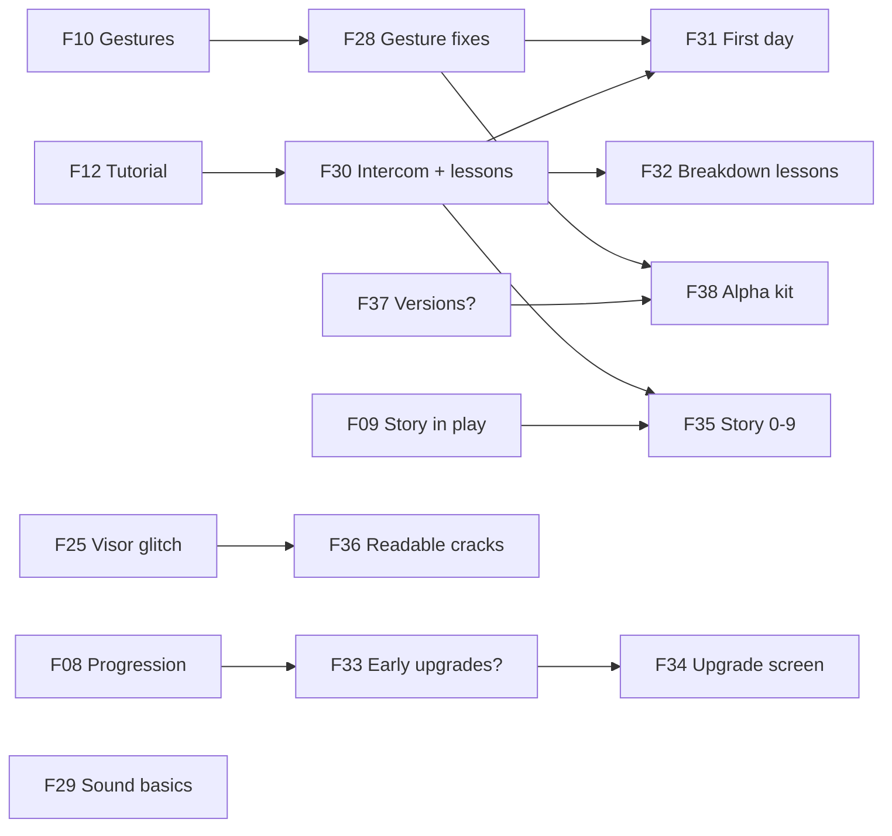
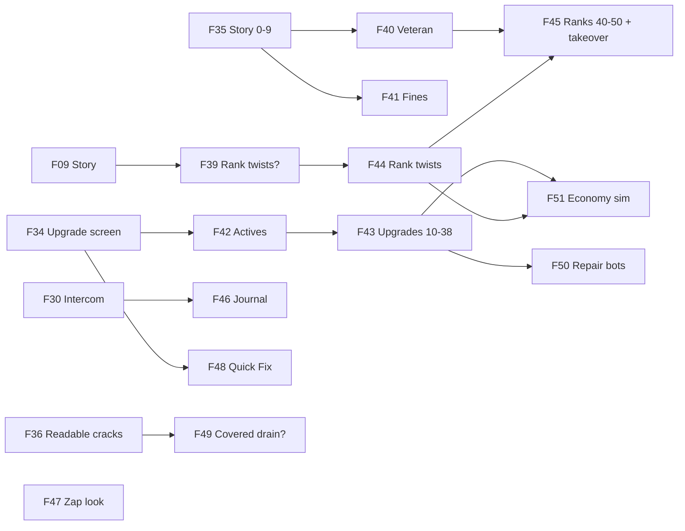
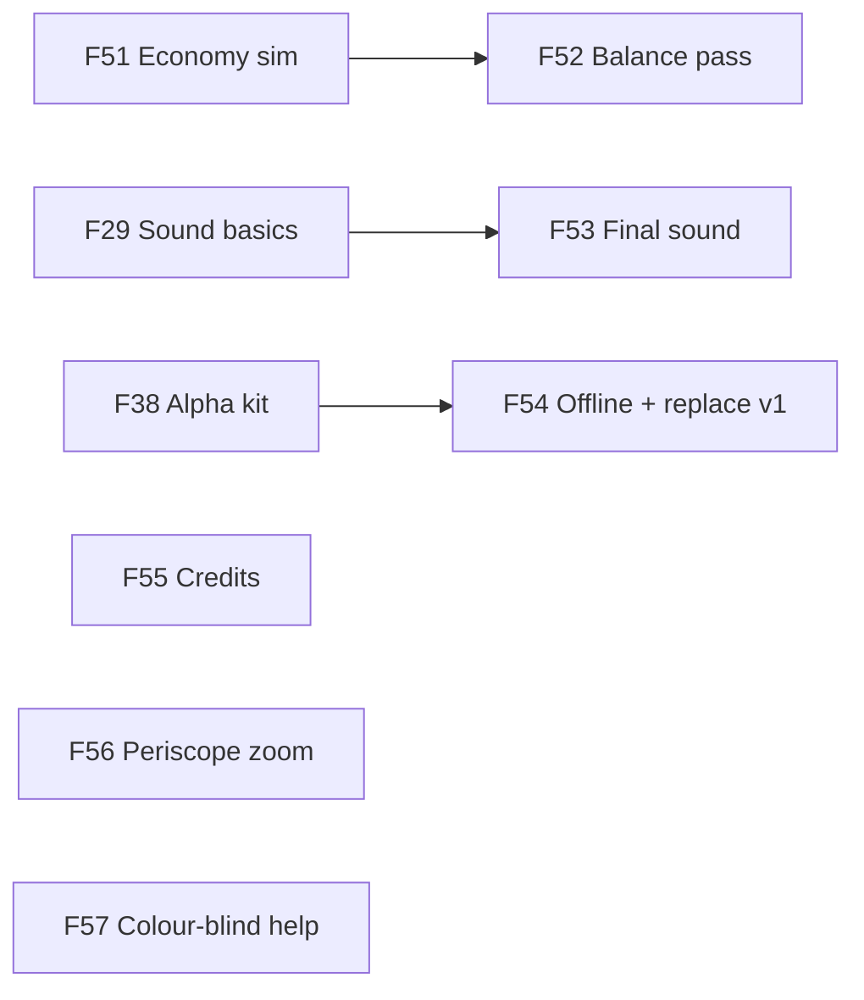

# Goops remake — what alpha, beta and 1.0 must have
> **DECIDED 2026-10-19 (Muzzy) — this changes the draft below:** alpha = the playable game ("story is beta. alpha is playable game") → **no upgrades and no story in alpha** (F33/F34/F35 moved to beta, F09 Story in play is must:beta); **rank twists: keep all three** (F39 is now "build them as v1", F44 merged into it); **Dev Kit ON for alpha**. Claude's defaults: placeholder sound in alpha; tutorial in alpha as plain how-to-play; versions 0.x until it replaces v1 (F37). Final milestones: ROADMAP M4–M6; summary: GDD §7.

> Sprint 06 · F07 task 3 · written 2026-10-19 by Claude. **This is a draft for you to edit.** Change anything: cross out rows, move them, rewrite the reasons. When you approve it, Claude copies the result into ROADMAP (milestones M4+) and GDD §7 Scope.
> Sources: GDD (all, esp. §7 "everything in v1 is a must; the story is new must work"), ROADMAP (M0–M3, Parking lot), STATE (built / not built), TDD, `design/story.md`, `design/progression.md`, `design/upgrades-map.md`, `research/v1-review.md`, `research/v1/PRD.md`, and a look at the code (`src/`, `content/`).
> Words: **must** = that release can't go out without it · **should** = we want it, but it can slip a release · **could** = nice if there's time · **later** = after 1.0 (stays in the parking lot) · **won't** = decided against.

## 1. The three releases, in one line each
| Release | Who plays it | What it proves |
|---|---|---|
| **Alpha** (the first release — no "prototype" release; sketches are just sketches) | You plus a handful of friends, on their own phones, from a private link. v1 stays live at the old address. | **Ranks 0–9 are fun and learnable without you in the room:** a new player gets through "your first day", the goo feels great to zap, a shift is tense in a good way, the three machines are fair, and they come back for "one more shift". |
| **Beta** | A wider group (friends of friends, maybe a public test link). | **The whole game exists, start to finish:** every rank 0–50, every v1 system, the whole story (the Veteran, fines, the takeover at 50). Rough edges and unbalanced numbers are allowed; nothing is missing. |
| **1.0** | Everyone. It replaces v1 at https://thebluemuzzy.github.io/GOOPS/ | **It's finished and it holds up:** balanced from rank 0 to 50, real sound, polish, works offline as an installed app, credits, no known serious bugs. |

The idea in one sentence: **alpha = the first 10 ranks done properly; beta = all 50 ranks, rough; 1.0 = all 50 ranks, polished.** Ranks 0–9 are where v1's "onboarding band" lives (first upgrades, all three machines unlock at ranks 2/4/6), so it's a natural, complete slice.

## 2. Every candidate item
Built? column: ✅ built in the remake · 🟡 partly · ❌ not built. "Ask Muzzy" = a taste call I can't make for you; my proposal is in the row so you can just say yes/no.

### The core shift (all built — listed so nothing is forgotten)
| Item | Built? | Release | Scope | Why |
|---|---|---|---|---|
| Spin the tank, piece falls in the middle, 30 columns around / 12 seen | ✅ F13, F14 | alpha | must | The heart of the game. Done. |
| Pieces: 54 shapes, "corrupted" pieces (corner-touching cells that break apart when they land), mirroring | ✅ `src/engine/pieces.ts` | alpha | must | v1 had them; built. |
| Lock delay, ghost/landing shadow, wall kick toggle (what a piece does when you rotate it into goop: the tank turns, or the piece slides over), no hard drop | ✅ F18 | alpha | must | Movement feel, as v1. |
| Hold-to-swap (1.5 s) | ✅ F18 | alpha | must | v1 control. |
| Merge → fill → zap below the pressure line | ✅ F13 | alpha | must | Core verb. |
| New shift loop: pressure → cracks (hill) → tank integrity → rupture → shift over; quota + score | ✅ F17, F27 | alpha | must | Your redesign, balanced 2026-10-19. |
| Starting junk by rank (3+) | ✅ `shift.json junkByRank` | alpha | must | v1 had it; built. |
| Colours by rank (4 → purple@10 → white@30 → black@50) | ✅ `shift.json colorsByRank` | alpha (ranks 0–9 use 4) | must | Built; what black *does* is open (below). |
| Jelly goo (+ Particle switch in Settings) | ✅ F15 | alpha | must | The "every second" feeling. |
| Score | ✅ F13 | alpha | must | Built. |
| v1's letter grade A/B/C/FAILURE on the end report | ❌ (end report = won/lost + why + score + cracks + XP) | — | won't (Ask Muzzy) | v1-review: two of its five categories measured the same thing; the new loop already says "quota met / why it ended". Proposal: drop it. If you miss it, it's a small should:beta. |
| v1's "win burst" (all colours spawn cracks when you win early) and the 75 s shift clock | replaced | — | won't | Your new loop replaced both (quota → play on until the rupture). |

### The job around the shift
| Item | Built? | Release | Scope | Why |
|---|---|---|---|---|
| The console is the main menu, periscope pull into the shift | ✅ F21 | alpha | must | Pillar 1. |
| Ranks 0–50 + XP + scraps (the upgrade money, 1 per rank) | ✅ F20 (`content/tuning/progression.json`) | alpha | must | Numbers are v1's; checked by a sim in beta. |
| Save (rank, XP, settings) | ✅ F20 `src/progress/save.ts` | alpha | must | Built. |
| Settings (goo style, wall kick, readout, volume rows) | ✅ F16 | alpha | must | Built. Volume rows exist but are switched off until there's sound. |
| Three breakdowns + repairs at the console (laser 4, visor 2, controls 6) | ✅ F23–F25 | alpha | must | Built and softened. |
| HUD (your layout) + plain-word messages at the stack | ✅ F26 | alpha | must | Message timing still waits on your playtest (F26 task 6). |
| Dev Kit in release builds | ✅ switch built (`src/main.tsx` + `content/devkit.json`). **It is ON today** (`inReleaseBuilds: true` — the BMUZ default: testers can open it until 1.0; `/deliver` turns it off at 1.0) | 1.0: off | must | v1 leaked "RANK SELECT" into the live game. **Ask Muzzy:** for alpha keep the whole Dev Kit on (friends can capture bugs, but can also tweak/peek), or ship it off? I'd keep it on for alpha (bug files are worth it), off at 1.0. |

### Phone & release basics
| Item | Built? | Release | Scope | Why |
|---|---|---|---|---|
| **F10 gesture fixes** (drag / tap / hold / swipe never misread) | 🔨 F10 is finding the conflicts now | alpha | must | Phone first, one thumb. A friend who keeps rotating by accident quits. |
| Phone performance (60 fps on a mid-range phone, full tank) | 🟡 budget in TDD §5, checked on PC + Playwright | alpha | must | One check on two real phones before friends get it. |
| **PWA install** (add to home screen, full screen, portrait) | 🟡 `public/manifest.json` + icons exist; no offline support | alpha: install · 1.0: offline | should:alpha · must:1.0 | Installed = full screen, so the browser's own swipe bars stop fighting swipe-up-for-console. Offline play is only needed at 1.0 (v1 had it). |
| **Remake version numbers** | ❌ no `version.json`; `package.json` says 0.1.0; v1 was 1.1.13 | alpha | must (Ask Muzzy) | Proposal: add `version.json` at 0.0.0 now → alpha is **0.x**, beta 0.x, and the public release is called **2.0.0** ("Goops 2"), so the number never goes backwards from v1's 1.1.13 at the same address. Alternative: plain 1.0.0. |
| Where alpha lives | ❌ | alpha | must (Ask Muzzy) | Proposal: a separate link (a private web build), v1 stays at the live address until 1.0. |
| Credits screen (fonts, art) | ❌ (`content/credits.json` exists) | 1.0 | must | Fonts are free licences that need credit lines; must be on screen before public. |

### Teaching — F12 tutorial
| Item | Built? | Release | Scope | Why |
|---|---|---|---|---|
| **Intercom** (static with key words in green) as one shared "voice" for tutorial + story; lessons written as data (a list of steps), not code | ❌ | alpha | must | v1's tutorial burned ~90 commits because it was code, not data (v1-review §5). Build the small step-runner once; tutorial and story both use it. |
| **"Your first day"** — rank 0, taught at the moment you need it | ❌ (F12 design open) | alpha | must | Friends must learn without you beside them; that's half of what alpha proves. |
| First-breakdown lessons (the first time the visor / laser / controls breaks: one intercom line + "swipe up to fix") | ❌ | alpha | must | Ranks 2, 4, 6 are inside alpha; a machine breaking with no explanation feels like a bug. |
| Operator Journal (the "?" button — what you've learned, growing with rank) | ❌ (v1 had a basic one) | beta | should | Nice reference, not needed to learn ranks 0–9 if the lessons work. v1 had it, so it's 1.0 must at the latest. |

### Story — F09 story in play
| Item | Built? | Release | Scope | Why |
|---|---|---|---|---|
| Rank titles (Trainee → … → Executive) | ❌ | alpha | must | Cheap, shows on the console, makes ranks feel like a job ladder. Names = Ask Muzzy (F09). |
| Employer intercom beats for ranks 0–9 ("policy", "for your safety") | ❌ | alpha | must | The "across ranks" feeling (dark-comedy discovery) needs at least a taste in alpha, or we can't tell if it works. |
| The Veteran: radio hijacks, upgrades as smuggled tools (from rank 10) | ❌ | beta | must | Story says he arrives at rank 10, outside alpha. |
| Fines at the end of a shift | ❌ | beta | must (Ask Muzzy) | v1 story idea, never designed as a rule. Do fines take XP/scraps (real bite) or are they just words on the report (flavour)? F09 decides. |
| Ranks 40–49 content + the takeover at rank 50 (+ the brain in a jar) | ❌ | beta | must | "The story is new, must work" — beta is the whole game, so the ending is in beta. What the takeover *is* = F09. |
| **Black goop at rank 50** | 🟡 the 7th colour exists, does nothing special | beta | must (Ask Muzzy) | "Decide later (rank 50)". Proposal: it belongs to the takeover beat, decided with F09. |

### Upgrades (engine ready, F22)
| Item | Built? | Release | Scope | Why |
|---|---|---|---|---|
| Upgrade screen at the console (spend scraps, see levels) | ❌ | alpha | must (Ask Muzzy) | Scraps are earned from rank 1; with nothing to buy, rank-ups feel empty, and "one more shift" is partly about the next upgrade. **Smaller alternative:** no upgrades in alpha, test the shift alone. I recommend the screen + a few upgrades. |
| Early upgrades, ranks 2–9 (Circuit Stabilizer, Capacitor Efficiency, Gear Lubrication, Dense Goop, Auto-Popper → "slower depressurise", Pressure Control → slower pressure, Focus Mode) | 🟡 most are one number the engine already reads (`design/upgrades-map.md`) | alpha | must | Fast to add because the engine is ready; their new-loop versions are your taste calls (a ❓ first). |
| Cooldown Booster (rank 5, the first *active* ability: charges up, you tap to fire) | ❌ needs a fire effect + a button in the HUD | beta | must | Actives need new HUD + an equip screen; keep alpha to passives. Ask Muzzy if you'd rather pull one active into alpha to test the feel. |
| Upgrades ranks 10–38 (junk, mixer, cracked bands), hold viewer, next-piece window, 2nd/3rd ability slots | ❌ | beta | must | v1 had them all. |
| Your three: tougher tank, slower depressurise, more seal venting | ✅ hooks ready | alpha (as part of the early set) | should | Already wired; just need a name, rank and price. |
| Quick Fix (fewer repair steps) | ✅ hook ready | beta | should | "Awesome for later game runs" (you). |
| Repair bots (little bots seal cracks for you) | ❌ parking lot | beta | could (Ask Muzzy) | Idea: they could BE the empty rank-40s upgrade band (there's none in v1), and the GDD already says high cracks are for "repair-bot upgrades later". Otherwise: later. |
| Economy check: a sim of ranks 0–50 + all upgrades | ❌ (crack/integrity bots exist: `npm run bots`) | beta | must | v1 never balanced past rank 10 (v1-review). Do it before 1.0's balance pass. |

### Rank twists from v1 (ranks 20–50)
| Item | Built? | Release | Scope | Why |
|---|---|---|---|---|
| Multi-colour pieces (rank 20+), expanding cracks (rank 30+), wild goop (rank 40+) | ❌ | beta | must (Ask Muzzy) | "Everything in v1 is a must", but v1 never tested them with players, and v1-review suggested keeping at most one. Each needs a story reason (pillar 4). Proposal: a ❓ in beta decides keep / cut / redesign per twist. |

### Look, feel, sound — and the parking lot
| Item | Built? | Release | Scope | Why |
|---|---|---|---|---|
| **Sound: basic effects** (land, merge, zap, seal, machine breaks, rupture), code-made placeholders | ❌ (framework audio module + Dev Kit sound tab ready) | alpha | must | "The goop is so satisfying to squish and zap" can't be judged in silence. Cheap placeholders are fine. |
| Sound: final effects + music + intercom voice | ❌ | 1.0 | must | v1 only had beeps; 1.0 needs real sound. |
| **Readable cracks** 1–3: bubbles from open cracks, x-ray box when goop covers one, sealed cracks look fixed (and never crack again) | ❌ parking lot | alpha | should | Helps brand-new players see what the job is. Looks only — no rule change (except "never crack again", tiny). |
| Readable cracks 4: goop covering a crack halves its drain | ❌ | beta | could (Ask Muzzy) | A **rule** change (covering becomes worth doing before you can zap) — needs a bot rerun, so not in alpha. |
| The zap look (explode/harden, not pop) | ❌ open since 2026-10-17 | beta | should | Big for the "every second" feeling, but a placeholder is OK for alpha. Sketch first. |
| **Periscope zoom** (pull down = zoom into the visor) | ❌ parking lot | 1.0 | should | You called it polish. |
| Colour-blind help (a mark per colour) | ❌ | 1.0 | should (Ask Muzzy) | A colour-matching game with up to 7 colours; worth it before the public release. |
| **Pixel look** (pixel UI, later pixel goop) | ❌ parking lot | later | could | A whole second look; after 1.0. |
| The goop acts a little on its own (creeps, reaches) | ❌ parking lot (my idea) | later | could | Would bend the "goo never decides a rule" pillar. |
| Free goo (L5) as its own game | — | later | — | A different game (you, 2026-10-17). |

## 3. Proposed build milestones after M0
M1–M3 are built. M0 still holds the open questions F07 (this), F09 (story), F10 (gestures), F12 (tutorial). New feature IDs start at F28. Types: 🎮 player-facing · 🧱 foundation · ✨ polish · ❓ your decision. `needs:` = what must be done first.

### M4 — Alpha: friends can play ranks 0–9  (→ alpha)
Goal: a friend installs it from a link, learns it from "your first day", plays through rank 9 with all three machines and a first handful of upgrades, and hears it.
- 📐 F28 🎮 Gesture fixes (from F10's list) — must:alpha · needs: F10
- 📐 F29 🧱 Sound basics: code-made effects through the framework audio module, volume rows on — must:alpha
- 📐 F30 🧱 Intercom + lesson runner (one voice; lessons and story beats are data files) — must:alpha · needs: F12
- 📐 F31 🎮 Your first day (rank 0 tutorial) — must:alpha · needs: F30, F28
- 📐 F32 🎮 First-breakdown lessons (visor, laser, controls) — must:alpha · needs: F30
- 📐 F33 ❓ Early upgrades: which ones for ranks 2–9, their new-loop versions and prices — must:alpha · needs: F08
- 📐 F34 🎮 Upgrade screen at the console + the early upgrades — must:alpha · needs: F33, F22, F21
- 📐 F35 🎮 Story ranks 0–9: rank titles + Employer beats — must:alpha · needs: F09, F30
- 📐 F36 ✨ Readable cracks: bubbles, x-ray box, sealed look — should:alpha · needs: F25
- 📐 F37 ❓ Version numbers + where alpha lives (+ bug capture on for friends?) — must:alpha
- 📐 F38 🧱 Alpha release kit: version.json, installable full-screen PWA, Dev Kit on/off per Muzzy's call (on today), 60 fps on two real phones — must:alpha · needs: F37, F28

### M5 — Beta: the whole job, rank 0 to the takeover  (→ beta)
Goal: every rank 0–50 plays, every v1 system is in, the story reaches its ending; numbers can still be rough.
- ⏳ F39 ❓ Rank twists: multi-colour (20), expanding cracks (30), wild (40), black goop (50) — keep, cut or redesign, each with a story reason — must:beta · needs: F09
- ⏳ F40 🎮 The Veteran: radio hijacks + smuggled upgrades — must:beta · needs: F35
- ⏳ F41 🎮 Fines on the end report — must:beta · needs: F09, F35
- ⏳ F42 🎮 Active abilities: equip slots + the charge button in the HUD (Cooldown Booster first) — must:beta · needs: F34
- ⏳ F43 🎮 Upgrades ranks 10–38 + hold viewer + next-piece window — must:beta · needs: F34, F42
- ⏳ F44 🎮 Rank twists, built as F39 decides — must:beta · needs: F39
- ⏳ F45 🎮 Ranks 40–49 + the takeover at rank 50 — must:beta · needs: F40, F44
- ⏳ F46 🎮 Operator Journal — should:beta · needs: F30
- ⏳ F47 ✨ The zap look (sketch first) — should:beta
- ⏳ F48 🎮 Quick Fix upgrade (fewer repair steps) — should:beta · needs: F34
- ⏳ F49 ❓ Covered cracks drain half? (bot rerun) — could:beta · needs: F36
- ⏳ F50 🎮 Repair bots (maybe the rank-40s upgrade band) — could:beta · needs: F43
- ⏳ F51 🧱 Economy sim: ranks 0–50, every upgrade — must:beta · needs: F43, F44

### M6 — 1.0: polished, balanced, replaces v1  (→ 1.0)
Goal: Goops 2 goes live at the old address, works offline, sounds finished, and holds up from rank 0 to 50.
- ⏳ F52 🧱 Balance pass from beta playtests + the sim — must:1.0 · needs: F51
- ⏳ F53 🎮 Final sound + music + intercom voice — must:1.0 · needs: F29
- ⏳ F54 🧱 Offline install + replace v1 at the live address (what happens to v1 saves: fresh start?) — must:1.0 · needs: F38
- ⏳ F55 🎮 Credits screen — must:1.0
- ⏳ F56 ✨ Periscope zoom — should:1.0
- ⏳ F57 🎮 Colour-blind help — should:1.0

### Later (after 1.0, parking lot)
Pixel look · goop that acts a little on its own · free goo (L5) as its own game.

**Size check:** alpha = 11 features, 2 of them your decisions (F33, F37), one a should (F36). The two big ones are the lesson runner + first day (F30–F31: v1's tutorial was the most expensive thing it built) and the upgrade screen (F34). If alpha feels too big, the first thing to cut is F34 (ship alpha with no upgrades), then F36.

## 4. Biggest open questions
1. **Upgrades in alpha, or not?** I recommend the upgrade screen + passive upgrades for ranks 2–9 (fast, the engine is ready), actives in beta. The smaller option: alpha tests the shift alone.
2. **F09 only needs ranks 0–9 for alpha.** Can we split it — decide rank titles + the first Employer beats now, and fines / ranks 40–50 / the takeover / black goop before beta? That unblocks alpha sooner.
3. **The v1 rank twists** (multi-colour pieces, expanding cracks, wild goop): your rule says everything in v1 is a must, but none were ever played by real players. Keep all, keep one, or redesign — decided in beta (F39)?
4. **Version numbers and where alpha lives:** remake at 0.x until release, then "2.0.0" at the old address (v1 stays live until then)?
5. **Is sound really an alpha must?** I think the goo can't be judged silent, so cheap placeholder sounds go in alpha; final sound at 1.0.
